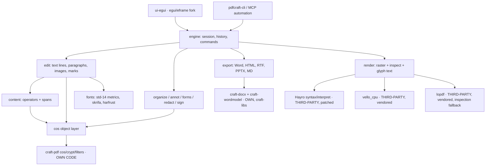

# Report B — Deep PdfCraft Source-Code Audit

| Field | Value |
| --- | --- |
| Date of research | 2026-11-28 |
| Repository | https://github.com/storytold/pdfcraft |
| Commit | `c34c6c5a0bd86d466f9f814c14b4cfdaa55cd7e2` (2026-11-27), workspace version 0.22.0 |
| Shared library audited | https://github.com/storytold/craft-libs at `0a6e42b80bfd586aee6ee1144aa98cf1ea37a844`, the revision PdfCraft pins |
| Tests examined | Test modules named below; 9,513 `#[test]` functions counted across the repo; build and run results in Report H |
| Confidence | High for structure and delegation. Behavioural claims were checked in Report H (15-file corpus): rendering, extraction, editing and saving worked, and the DOCX export losses are listed there. |

## 1. Answer to the key question

**PdfCraft really does edit existing content streams.** It is not only an overlay or annotation tool. Its "Edit text" path parses a page's content stream into operators, rewrites the operators of one text line or paragraph, and writes the stream back as a new object while keeping positioning operators (**Verified**: `crates/edit/src/text.rs:1–12`, `replace_line` at `crates/edit/src/text/rewrite.rs:25`, `rewrite_block` at `:311`). Saves are true incremental updates or full rewrites of the object graph (**Verified**: `craft-libs/crates/pdf/src/cos/writer.rs:274–279`).

The limits are substantial, and the project states them itself:

- New text keeps the source font only when every character has a glyph in it; otherwise it falls back to Helvetica (`text.rs:9–11`).
- Paragraph rewrites rewrap only within the paragraph's existing frame; nothing reflows across the page (`text.rs:12`).
- Vector paths cannot be edited: editable object kinds are `Added`, `Text` and `Image` only (`crates/edit/src/objects.rs`, `enum ObjectKind`).
- The font crate "reads font dictionaries, never embedded programs … cannot subset or re-embed" (`crates/fonts/src/lib.rs:1–5`).
- Its own gap register lists as missing "robust in-place editing of text PdfCraft didn't write … vector and object editing" (`docs/gaps.md:117–123`).

## 2. Source tree map

| Layer | Crate (path) | Lines | Role | Implemented by |
| --- | --- | --- | --- | --- |
| App entry | `apps/pdfcraft/src/main.rs` (`fn main` line 160, returns `eframe::Result`) | 2.7k | Desktop app | egui/eframe (fork) |
| CLI entry | `apps/pdfcraft-cli/src/main.rs` | 4.5k | `info`, `render`, `text`, `edit`, `combine`, `extract`, `split`, `check`, `audit`, `batch`, `run <tool>`, `mcp` | Own |
| Web | `apps/pdfcraft-web` | 0.4k | WASM build | eframe web |
| UI | `crates/ui-egui` | 152k | Viewer and editor UI | egui 0.37 |
| Engine | `crates/engine` | 50k | Session, commands, history, export orchestration | Own |
| Object layer | `crates/cos` → `craft-pdf` `cos` feature | 4.1k + 29.5k | Parse, edit and save PDF objects | **Own** (craft-libs) |
| Content streams | `crates/content` → `craft-pdf` `content` | 0.2k | Operators with source spans, serialise back | Own, tokenizer from `hayro-syntax` for inline images |
| Filters, crypt | `crates/filters`, `crates/crypt` → `craft-pdf` | thin | Filter chain, security handler | Own (craft-libs), Flate via `flate2`/zlib-rs |
| Typed model | `crates/model` | 0.6k | Page tree views, inherited attributes | Own |
| Rendering | `crates/render` | 40.6k | Rasterise, inspect, extract glyphs | **Delegates** to Hayro + vello_cpu ("bootstrap") plus a lopdf inspection adapter |
| Fonts | `crates/fonts` | 9.3k | Std-14 metrics, encodings, fallback shaping for new text | Own + `skrifa`, `harfrust` |
| Editing | `crates/edit` | 42.5k | Text lines and paragraphs, images, page marks, flatten, colour conversion | Own |
| Annotations | `crates/annot` | 16.6k | Acrobat comment types and appearances | Own |
| Pages | `crates/organize` | 13.7k | Insert, delete, move, rotate, merge, split | Own |
| Forms | `crates/forms`, `crates/xfa`, `crates/js` | 21k + 25k + 17k | AcroForm, XFA, JavaScript (Boa engine) | Own + `boa_engine` |
| Signing | `crates/sign` | 18.3k | Signatures | Own + RustCrypto + `aws-lc-rs` (native) |
| OCR | `crates/ocr` | 4.8k | Invisible text layer | `ocrs`/`rten` + optional external `tesseract` |
| Export | `crates/export` | 4.3k | PDF → DOCX, PPTX, HTML, RTF, Markdown | Own heuristics + craft-libs writers |
| Others | `redact`, `optimize`, `preflight`, `a11y`, `measure`, `print`, `compare`, `audit`, `create`, `xfdf` | — | Acrobat-parity features | Own |

Line counts exclude `vendor/`. See `diagrams/pdfcraft_subsystems.md`.

## 3. PDF parsing: own code or delegated?

There are two parsers. The **editing/saving path is ArtCraft's own code**; the **viewing/rendering path is Hayro**, a third-party crate.

| Capability | Status | Evidence |
| --- | --- | --- |
| Lexer and object parser | **Own, Verified** | `craft-pdf/src/cos/parser.rs:1–5` ("tolerant of common real-world damage … never panics"); depth limit `MAX_DEPTH = 128`, `MAX_NODES = 1<<22` |
| Xref tables and streams, chains, revisions | **Own, Verified** | `cos/document/reader.rs` (`read_xref_chain_materialized`, generation repairs at lines 363–483), `cos/document/xref.rs` |
| Object streams | **Own, Verified** | `cos/document/state.rs:210` (`struct ObjStm`), `cos/document/open.rs` |
| Page tree, inheritance | **Own, Verified** | `pdfcraft/crates/model/src/lib.rs` (`INHERITABLE` = Resources, MediaBox, CropBox, Rotate; `MAX_USER_UNIT`) |
| Content streams | **Own operator parser, Verified**; uses `hayro-syntax`'s tokenizer only for inline-image ends | `craft-pdf/Cargo.toml` feature `content`; `pdfcraft/crates/content/Cargo.toml` comment |
| Resources, fonts, images, Form XObjects | Own traversal in editing (`MAX_FORM_DEPTH`, `MAX_FORM_VISITS` in `edit/src/text/lines.rs`); rendering interprets them via Hayro | Verified |
| Transparency groups | Rendering only, in patched Hayro (patch #2027: reads `/I` and `/K`) | `craft-libs/vendor/README.craft-reader.md` |
| Annotations | Own (`crates/annot`) | Verified |
| Metadata | Own inspection (`render::inspect::DocInfo`), XMP not audited | Verified / Unknown |
| Incremental updates | **Own, Verified**: `write_incremental` appends edits and a cross-reference section; a broken chain forces a full rewrite | `cos/writer.rs:1–5, 274–279` |
| Encryption | **Own, Verified**: R2–R6 (RC4 40–128, AES-128, AES-256), decrypt, encrypt and create | `craft-pdf/src/crypt.rs:1–14` |
| Malformed PDFs | Tolerant parser, xref generation repair, lopdf fallback for "compatibility repairs" | `cos/parser.rs`, `render/src/lib.rs:3–6` |

**Bottom line:** ArtCraft implements the low-level COS layer itself (parser, xref, object streams, writer, encryption). It delegates page interpretation, fonts-for-rendering and rasterisation to Hayro.

## 4. PDF rendering

| Aspect | Finding | Label |
| --- | --- | --- |
| Backend | `craft-pdf` raster facade over **hayro-interpret + vello_cpu**; described as "bootstrap", to be replaced by an own `model`/DisplayList in milestones M1–M2 | **Verified** (`render/src/lib.rs:1–6`); the replacement is **planned, not implemented** |
| CPU vs GPU | CPU rasteriser (`vello_cpu`), premultiplied RGBA8 output | Verified (`craft-pdf/README.md`, "Reading and rendering") |
| Output limits | 8,192 px per side, 64,000,000 px total | Verified (`craft-pdf/README.md`) |
| Fonts when rendering | Hayro draws embedded fonts; Foxit standard-14 substitutes (BSD-3-Clause) for non-embedded base fonts; an installed CJK face as a viewer-only last resort | Verified (`NOTICE`; `render/src/system_font.rs:1–11`) |
| Transparency, soft masks, blend, gradients, patterns | Handled by Hayro with ArtCraft patches (soft-mask gradient fills, tiling patterns, group isolation and knockout) | Verified via the patch ledger. Report H: 50% / 35% alpha fills rendered with ink F1 0.998 vs Poppler (one test page). |
| Fidelity diagnostics | The facade warns that "diagnostics … are not a fidelity certificate"; it does not emit `UnsupportedFont` | Verified (`craft-pdf/README.md`) |
| Parallel rendering | `RenderPool` with `RenderRequest`/`Tile` types exported by `crates/render` | Verified (API); performance Unknown |
| Large documents | Budgets on streams (256 MiB default per stream), images and page-tree work (100,000 entries) | Verified (`craft-pdf/README.md`) |

## 5. PDF editing: traced operations

| Operation | Status | Evidence |
| --- | --- | --- |
| Select text | **Implemented** via `render::text::PageText` (glyph rects, quads, words, lines, `glyphs_in`, `column_text`) | `render/src/text.rs:63–74` (`TextGlyph`) |
| Edit existing text | **Implemented, partial**: one stream rewritten as a new object, positioning operators kept; Helvetica fallback for missing glyphs | `edit/src/text.rs:1–12`; `rewrite.rs:25, 311` |
| Change font | **Partial**: reuse the source font or substitute; there is no glyph program access for document fonts | `fonts/src/lib.rs:1–5` |
| Move or resize text | Move: **Implemented** (`move_objects`, `MAX_MOVE_OBJECTS = 1000`); resizing via `BlockStyle` rewrites | `edit/src/objects.rs` |
| Edit or replace images | **Implemented** (`change_image`, `page_images`, `turn_by_degrees`) | `edit/src/images.rs:2489` |
| Edit vector paths | **Not implemented** (`ObjectKind` has no path kind; `edit.vector-edit` planned) | `edit/src/objects.rs`; `docs/gaps.md:117–123` |
| Delete objects | **Implemented** for text, images and added content (`delete_content`, `clear_block`) | `edit/src/lib.rs` exports |
| Add text | **Implemented**: added content in marked-content artifacts using std-14 or embedded faces | `edit/src/lib.rs:1–21`; `edit/src/added.rs` |
| Page rearrangement | **Implemented**: flattens the page tree to one `/Pages` node | `organize/src/lib.rs:1–10` |
| Merge, split | **Implemented** (CLI `combine`, `extract`, `split`) | `apps/pdfcraft-cli/src/main.rs` usage text |
| Save | **Implemented**: incremental or full rewrite, atomic, with autosave claimed on the website | `cos/writer.rs`; autosave not traced |

## 6. Other subsystems

- **Undo/redo:** snapshot-based, `MAX_UNDO = 100`; snapshots share unchanged data (`engine/src/history.rs:1–5`). **Verified.**
- **Serialization:** serde for settings and automation JSON; documents are saved as PDF. **Verified.**
- **Background processing:** render pool and tiles; an OCR worker binary (`apps/pdfcraft-ocr-worker`); cancellation callbacks in `craft-pdf` opening. **Verified.**
- **Error handling:** `thiserror` error enums; `#![deny(clippy::unwrap_used, expect_used, panic, …)]` in every crate audited; `unsafe_code = "forbid"` workspace lint (`Cargo.toml` `[workspace.lints.rust]`). **Verified.**
- **Text extraction for export:** `reading_blocks` groups lines into paragraphs "as a reader sees them, including text drawn by form XObjects (Export to Word, HTML and RTF)" (`edit/src/text/blocks.rs:395–399`). Each `TextLine` carries text, box, word ink boxes, font resource name, `/BaseFont`, size, bold/italic flags, RGB colour, rotation frame and baseline (`edit/src/text.rs:84–160`). **Verified.**

## 7. PdfCraft's own PDF→DOCX exporter

This is the part closest to our project, so it was traced end to end.

1. `engine/src/compare.rs:229–322` builds `pdfcraft_export::Page` from `reading_blocks_checked`, `reading_images`, `page_background` and `page_rules`.
2. Bold and italic are **guessed from the font name** (`weight_and_slant`, `compare.rs:221–224`: "bold", "black", "heavy", "italic", "oblique").
3. **The font family is discarded.** `export::Block` has no font field (`export/src/layout.rs:3–21`), and the DOCX writer sets one body font for the whole document: `const FONT: &str = "Arial"` (`export/src/as_docx.rs:46`).
4. Headings are paragraphs set ≥1.6× (level 1) or ≥1.25× (level 2) the body size (`layout.rs:119–129`).
5. Tables are detected from aligned short blocks plus ruled lines (`tables`, `layout.rs:385`; `COL_TOL = 4.0`, `MAX_COLS = 63`).
6. Reading order is a column-walking heuristic (`reading_order`, `layout.rs:634`).
7. A page with rotated text, or text overlapping an image or watermark-sized text, becomes **absolutely positioned text boxes and pictures**; every other page flows (`as_word.rs:320–345`, `positioned_page` at `:374`).
8. Vector artwork is not exported, apart from ruled lines used as table borders and a page background colour (`Page` fields `rules`, `background`).
9. The automation tool's own description says: "Font matching and vector graphics remain limited" (`crates/automation/src/tools.rs:1489`). The gap register says a "Word export that keeps layout" is missing (`docs/gaps.md:193–216`).

**Verdict on the exporter:** functional but basic. It is a heuristic flow converter with a positioned-page fallback. It is useful as a **baseline to beat**, not as a foundation.

## 8. Dependencies that matter

Third-party: `hayro` 0.7.1 / `hayro-syntax` 0.7.2 / `hayro-interpret` 0.7.0 (patched, Apache-2.0 OR MIT), `vello_cpu` 0.0.8 (vendored), `lopdf` 0.45 (vendored), `skrifa`, `harfrust`, `kurbo`, `ocrs` 0.13.1 + `rten` 0.26, `boa_engine`, `aws-lc-rs`, RustCrypto crates, egui/eframe 0.37 (fork). Source: `Cargo.toml:100–140`, `Cargo.lock`.

Correction after Report H: `krilla` 0.8.2 is listed in the workspace `[patch]` table (`pdfcraft/Cargo.toml:183`), but no PdfCraft crate depends on it. Cargo reports the patch as unused, and it is absent from the `pdfcraft-cli` graph (`evidence/dependency-licences.txt`). Krilla is used by WordCraft's PDF export (Report C).

## 9. Limitations of this audit and open questions

- Rendering fidelity, text-selection accuracy and export quality are behavioural, so they are measured in Report H.
- The "replace Hayro with an own DisplayList" plan (ADR-0004) is a roadmap item; its timing is **Unknown**.
- The XMP metadata, structure-tree (`a11y`) and preflight crates were not audited in depth.
- **Open question:** how much of the patched Hayro will be upstreamed? Each patch is "meant to go upstream" (`Cargo.toml:175`), but the fork exists today.
