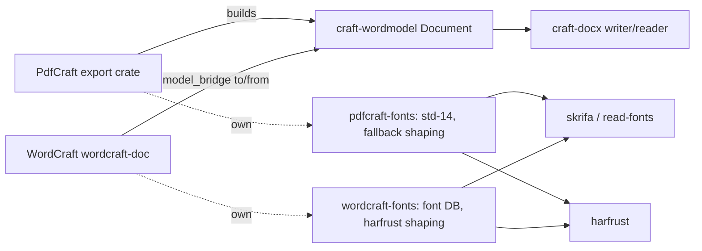

# Report C — WordCraft and Document Engine Audit

| Field | Value |
| --- | --- |
| Date of research | 2026-11-28 |
| Repository | https://github.com/storytold/wordcraft |
| Commit | `72ca96a27c795d6289775f6c12954c2cdbd62908` (2026-11-27); workspace version 0.18.1 (the website lists v0.19.1) |
| Shared library audited | craft-libs at `0b8bbaf4c842da2d47de7b3fddd7170ba6115541` (WordCraft's pin) and `0a6e42b8…` (PdfCraft's pin) for `craft-docx` / `craft-wordmodel` |
| Tests examined | `crates/layout` (42 test files), `crates/docx` (53), `crates/doc` (43); 5,786 `#[test]` functions in the repo; craft-docx has 86 test files |
| Confidence | High on architecture; Medium on fidelity (it is the project's own estimate, and WordCraft was not built here) |

## 1. Bottom line

WordCraft is a clean-room Word re-implementation with its **own document model, its own layout engine and native OOXML read/write**. For us the valuable piece is not WordCraft itself but the **shared `craft-docx` + `craft-wordmodel` crates** (MIT OR Apache-2.0) it and PdfCraft both use. They can express everything a reconstructed document needs: sections with page size and columns, floating anchored text boxes and pictures, native tables, styles and headers/footers. WordCraft's layout engine is **not** a faithful stand-in for Word. Its own parity document estimates "~55%" and says "nothing has been compared page-for-page with Word on real documents, and the default font can't match Word's metrics" (`docs/layout-parity.md:14–16`).

## 2. Architecture

| Crate | Lines | Role | Key dependencies |
| --- | --- | --- | --- |
| `crates/doc` (`wordcraft-doc`) | 29.8k | Application document model: stories, blocks, paragraphs, runs, tables, sections, styles, numbering, fields, floats, shapes, math | serde, unicode-segmentation |
| `crates/docx` (`wordcraft-docx`) | 16.4k | Bridge: "Delegates file-format parsing and serialization to `craft-docx`, adapting between the shared `craft-wordmodel` and WordCraft's application document model" (`crates/docx/src/lib.rs:1–4`) | craft-docx, craft-wordmodel |
| `crates/layout` (`wordcraft-layout`) | 49.6k | Shaping, first-fit line breaking, tabs, lists, tables, pagination, headers/footers, floats, hit-testing (`crates/layout/src/lib.rs:1–8`) | wordcraft-fonts, unicode-linebreak, unicode-bidi, craft-metafile |
| `crates/fonts` (`wordcraft-fonts`) | 8.9k | Font database (bundled OFL + system), metrics, outlines, shaping (`crates/fonts/src/lib.rs:1–6`) | skrifa, harfrust, wuff, brotli-decompressor |
| `crates/render` | 6.0k | Rasterises the layout display list with `vello_cpu` | vello_cpu, craft-metafile |
| `crates/pdf` | 6.2k | PDF export through craft-pdf/Krilla with embedded font subsets | craft-pdf |
| `crates/validate` | 40.3k | OOXML structural validator, "written from the specification" (`crates/validate/src/lib.rs:1–12`) | zip, quick-xml, craft-xml (no dependency on wordcraft-doc) |
| `crates/engine`, `crates/ui-egui` | 101k, 92k | Commands, undo, UI | egui |
| `apps/wordcraft-cli` | 3.3k | `convert`, `info`, `text`, `inspect`, `render`, `run`, `validate`, `mcp`, `parity` | — |

## 3. Document model findings (Verified unless noted)

| Feature | Representation | Evidence |
| --- | --- | --- |
| Document, stories | `Document` with a main story and parts (headers, footers, notes, comments, **text boxes**); `Arc`-shared blocks for cheap snapshots | `crates/doc/src/lib.rs:1–9` |
| Paragraph and run | `para` module (`run.rs`, `inline_object.rs`, `float.rs`) with `props/char_props.rs` and `para_props.rs` | `crates/doc/src/para/` |
| Character formatting | `CharProps` (font, East Asian and complex-script fonts, size, bold, italic, colour, …) | `props/char_props.rs` |
| Tables | Block-level tables; cells hold block lists | `lib.rs:4–5`, `table.rs` |
| Sections and columns | `SectionProps` with page setup, `Columns { count, space, widths, … }`, RTL columns, balanced columns | `section.rs:644, 762–880` |
| Headers and footers | Parts plus per-section references and page-number fields | `section.rs:1`, `lib.rs` |
| Floating elements | `Float { wrap, h_rel, v_rel, x, y, h_align, v_align, rot, flip, wrap_polygon, z, … }`; anchors Page, Margin, Column, Paragraph, Character, Line…; wraps Square, Tight, Through, TopAndBottom, BehindText, InFrontOfText | `para/float.rs:6–200` (struct at `:136`) |
| Shapes | `ShapeKind` incl. TextBox, Freeform, Line, connectors | `para/inline_kinds.rs:5–40` |
| Images | Inline objects and floats; picture effects (`picfx.rs`) | Verified (types); behaviour not tested |

## 4. Answers to the required questions

| # | Question | Answer | Label |
| --- | --- | --- | --- |
| 1 | Native OOXML? | Yes: `craft-docx` (45k lines) parses and writes WordprocessingML, plus Flat OPC and Word 2003 XML (`craft-docx/src/flat.rs`, `wordml2003_write.rs`) | Verified |
| 2 | External document engine? | No; no LibreOffice or other engine in the DOCX path | Verified |
| 3 | Custom layout engine? | Yes: `wordcraft-layout`, 49.6k lines, explicitly targeting Word for Mac 16.113.4 behaviour | Verified |
| 4 | Exact page geometry? | Page size and margins per section are modelled; whether Word lays the result out identically depends on Word, not WordCraft | Verified (model) / Unknown (Word fidelity) |
| 5 | Floating elements? | Yes (`Float`, `Wrap`, `Anchor`, z-order) | Verified |
| 6 | Positioned text? | Yes: text boxes anchored to the page with absolute offsets; PdfCraft's exporter already writes them through `craft-wordmodel` (`pdfcraft/crates/export/src/as_word.rs:374–454`) | Verified |
| 7 | Real Word tables? | Yes: `craft_wordmodel::Table` with grid widths, borders and cell props; PdfCraft writes them (`as_word.rs` `table`) | Verified |
| 8 | Section-level formatting? | Yes (`SectionProps`) | Verified |
| 9 | Can the model hold PDF-derived geometry? | **Partly.** It can hold page-anchored boxes, paragraph indents and spacing, tab stops, exact line spacing and character spacing. It cannot hold per-glyph positions; nothing in DOCX can, short of one text box per glyph run. | Inferred |

## 5. Text measurement, line breaking and rendering

- **Line breaking:** UAX #14 plus Word-specific exceptions, kinsoku for Japanese, first-fit breaking (`layout/src/lib.rs:3`; `docs/layout-parity.md` checklist). **Verified.**
- **Shaping:** `harfrust` (Rust HarfBuzz port) via `wordcraft-fonts::shape`, producing glyph ids, clusters and advances in font units. **Verified.**
- **Fidelity to Word:** self-assessed at "~55% (estimated), 90–145 h to full", never compared page-for-page with Word on real documents (`docs/layout-parity.md:14–16`). **Verified as a statement; not independently measured here.**
- **Rendering:** CPU rasteriser over the layout display list using `vello_cpu` (`crates/render/src/lib.rs:1`). PDF export embeds font subsets via Krilla (`crates/pdf/Cargo.toml` description). **Verified.**

## 6. DOCX import and export details relevant to us

| Topic | Finding | Label |
| --- | --- | --- |
| Font table on write | Writes `word/fontTable.xml` naming each font with generic family and pitch so readers substitute sensibly (`craft-docx/src/write/font_table.rs:1–5`) | Verified |
| Embedded fonts | **Reading** embedded fonts is implemented (de-obfuscation, `craft-docx/src/fonts.rs`). **Writing** new embedded fonts: no code path found (no `w:embedRegular` emission under `src/write/`) | Verified (read) / Inferred (not written) |
| Anchored drawings | Writes `wp:anchor` vs `wp:inline` per `Float::wrap` (`craft-docx/src/write/story/object.rs:290, 410, 644`) | Verified |
| Encryption | Reads and writes encrypted DOCX (`craft-docx/src/crypt.rs`; re-exported `encrypt`, `decrypt`) | Verified |
| Validation | `wordcraft-cli validate` exits 0 pass / 1 fail / 2 incomplete | Verified (usage text) |

## 7. Relationship between PdfCraft and WordCraft

- **Shared today:** the DOCX writer and model (`craft-docx`, `craft-wordmodel`), the PDF writer facade (`craft-pdf` → Krilla), XML/ZIP/OPC crates. **Verified.**
- **Not shared:** typography. PdfCraft and WordCraft each have their own font crate; both sit on `skrifa` and `harfrust`. **Verified.**
- **Not shared:** layout. PdfCraft's exporter does its own heuristics; it does not run WordCraft's layout to check its output. **Verified.**
- **Hypothesis:** WordCraft's layout could be a quick feedback signal for our DOCX output (render with `wordcraft-cli render`). Because of the ~55% Word-parity self-estimate it cannot replace rendering in Microsoft Word.

## 8. Limitations and open questions

- WordCraft's CLI was built (14 min 33 s, no errors). Only `validate` and `convert` were exercised, on PdfCraft's DOCX exports (Report H §9):
  - The validator caught malformed XML, dangling relationships and missing content types.
  - It skips `mc:AlternateContent`.
  - The renderer honoured text-box rotation.

  WordCraft's editing and its layout parity against Word were not tested.
- **Open:** whether `craft-docx` round-trips everything PdfCraft does not use (charts, SmartArt) cleanly. This is irrelevant to reconstruction.
- **Open:** craft-libs APIs change constantly and apps pin different revisions; a consumer must pin one revision and own upgrades.
