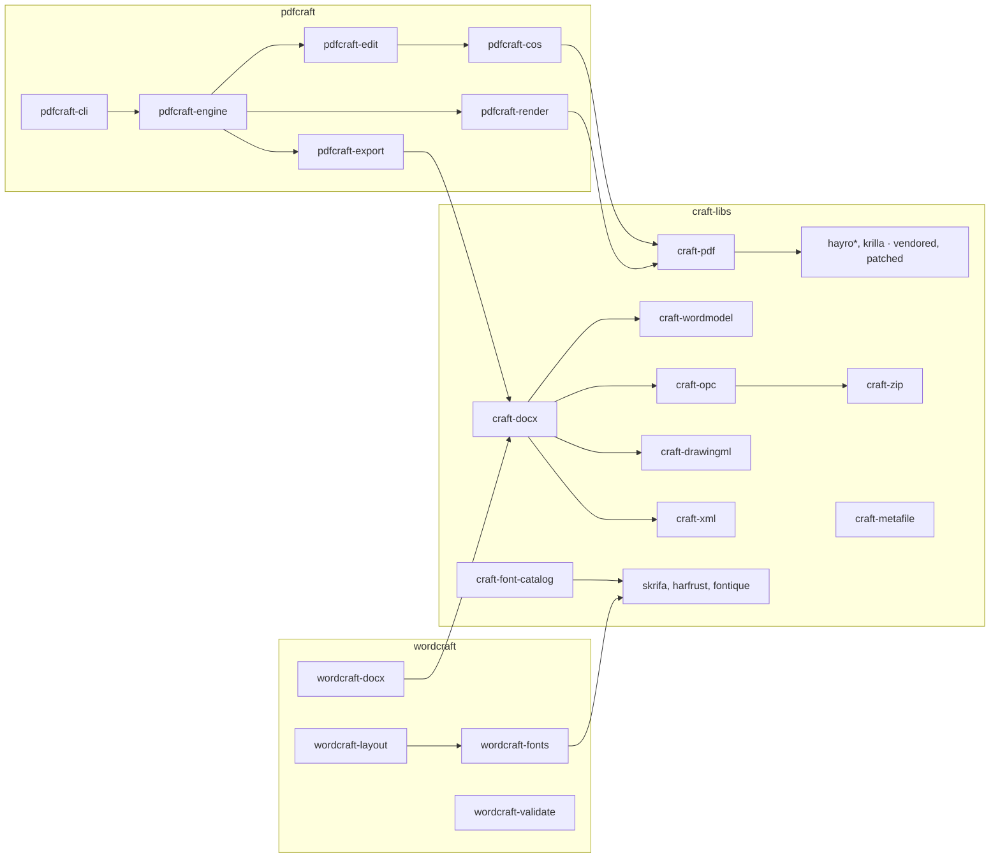

# Report E — Rust Architecture and Reusable Components

| Field | Value |
| --- | --- |
| Date of research | 2026-11-28 |
| Repositories and commits | pdfcraft `c34c6c5a0bd8…`; wordcraft `72ca96a27c79…`; craft-libs `0a6e42b8…` (PdfCraft pin), `0b8bbaf4…` (WordCraft pin) |
| Method | Workspace manifests, per-crate `[dependencies]`, line and test counts, lockfiles, crate docs |
| Confidence | High for structure and coupling; Low for performance (no benchmarks exist) |

## 1. Bottom line

The reusable value sits in **craft-libs**, not in the apps. Four crates are worth considering: `craft-docx` + `craft-wordmodel` (DOCX writing), `craft-metafile` (EMF vector output), and `wordcraft-validate` (DOCX structural checking). All are UI-free, dual-licensed MIT OR Apache-2.0 and well tested. **None is versioned or published**: consumers pin a craft-libs git commit, and the code changes by thousands of commits a month. The PDF text-extraction code we would most like lives in PdfCraft's app workspace. It is reachable most cheaply through `pdfcraft-cli`'s JSON automation tools in a separate process.

## 2. Workspace structure

| Workspace | Members | Notes |
| --- | --- | --- |
| pdfcraft | 34 crates + 4 apps + xtask; `vendor/` excluded (`Cargo.toml:1–5`) | Layered L2 (model, fonts) → L4 (edit, export, organize…) per crate docs; `unsafe_code = "forbid"` |
| wordcraft | 15 crates + 3 apps + xtask | `ui-egui` documented as "swappable: nothing below depends on it" |
| craft-libs | 242 crates (`crates/*`), vendored Hayro/Krilla/vello excluded from the workspace | Monorepo for all Craft apps: PDF, Office formats, fonts, images, CAD, audio, UI |

A copy lives in `diagrams/dependency_graph.md`.

## 3. Component evaluation

Maturity scale: **Mature-looking** (large, heavily tested, documented limits), **Functional**, **Partial**, **Experimental**.

| Component | Repository path | Purpose | Dependencies | Licence | Maturity | Coupling | Relevance |
| --- | --- | --- | --- | --- | --- | --- | --- |
| **craft-docx** | `craft-libs/crates/docx` (45k lines, 86 test files) | Read/write DOCX, Flat OPC, Word 2003 XML, encrypted packages | craft-wordmodel, craft-opc, craft-xml, craft-drawingml, craft-math, craft-offcrypto, quick-xml | MIT OR Apache-2.0 | Mature-looking | **Independent library** (no UI) | **High**: candidate DOCX writer |
| **craft-wordmodel** | `craft-libs/crates/wordmodel` (22k, 33 test files) | Word document model; `Document` derives `Serialize`/`Deserialize` (camelCase) (`src/lib.rs:98–101`) | serde, craft-math | MIT OR Apache-2.0 | Mature-looking | Independent | **High**: a JSON→DOCX path is possible |
| craft-drawingml | `craft-libs/crates/drawingml` (21k) | Shape transforms, colours, EMU units shared by DOCX/PPTX/XLSX | craft-xml, kurbo | MIT OR Apache-2.0 | Functional | Independent | Medium |
| **craft-metafile** | `craft-libs/crates/metafile` (14.5k) | WMF/EMF/EMF+ reader **and EMF/WMF writer** | kurbo, image | MIT OR Apache-2.0 | Functional | Independent | **Medium–High**: vector graphics into DOCX as EMF |
| craft-opc, craft-xml, craft-zip | `craft-libs/crates/{opc,xml,zip}` | Hostile-input-hardened OPC, XML and ZIP | quick-xml, zip | MIT OR Apache-2.0 | Functional | Independent | Medium (reading DOCX outputs safely) |
| **craft-pdf (`cos`, `crypt`, `filters`, `content`)** | `craft-libs/crates/pdf` (29.5k) | Own PDF object layer: parse, edit, incremental/full save, encryption, content-stream operators | hayro-syntax (only for `content`), flate2, RustCrypto | MIT OR Apache-2.0 | Functional, well tested | Independent, but `read`/`raster` features require root `[patch]` entries pinned to the same craft-libs revision (`crates/pdf/README.md`) | Medium: we would mostly read, and PDFium/MuPDF are stronger readers |
| pdfcraft-edit `text_lines` / `reading_blocks` | `pdfcraft/crates/edit/src/text/*` | Lines, words, paragraphs with font name, size, colour, baseline, rotation | pdfcraft-cos, -content, -fonts, -model, -annot | MIT OR Apache-2.0 | Functional | **App-specific** (PdfCraft workspace) | Medium: best used through `pdfcraft-cli run text_lines` / `text_paragraphs` |
| pdfcraft-export | `pdfcraft/crates/export` (4.3k) | Heuristic PDF→DOCX/HTML/RTF | craft-docx, craft-wordmodel | MIT OR Apache-2.0 | Partial (its own gap register) | App-specific | Low as code; useful as a baseline |
| pdfcraft-render `PageText` | `pdfcraft/crates/render/src/text*` | Glyph boxes, quads and direction for selection | Hayro | MIT OR Apache-2.0 | Functional | App-specific | Low–Medium |
| **wordcraft-validate** | `wordcraft/crates/validate` (40k) | DOCX structural validation with stable rule ids | zip, quick-xml, craft-xml, png | MIT OR Apache-2.0 | Functional | **Independent** (no wordcraft-doc dependency) | **Medium–High**: QA gate on our DOCX output |
| wordcraft-fonts (`word.rs`) | `wordcraft/crates/fonts/src/word.rs` | Word-style font resolution, metric twins, Windows line metrics | skrifa, harfrust | MIT OR Apache-2.0 | Functional | App crate, few deps | Medium: reference for font substitution |
| wordcraft-layout | `wordcraft/crates/layout` (49.6k) | Word-imitating layout | wordcraft-doc, -fonts | MIT OR Apache-2.0 | Partial (~55% Word parity, self-estimated) | Tightly coupled to wordcraft-doc | Low–Medium: fast preview only |
| craft-font-catalog, craft-font-subset | `craft-libs/crates/{font-catalog,font-subset}` | Installed font discovery; subsetting | fontique, skrifa, rustybuzz | MIT OR Apache-2.0 | Functional | Independent | Low–Medium |
| pdfcraft-ocr | `pdfcraft/crates/ocr` | ocrs + external Tesseract, ROVER merge, invisible text layer | ocrs, rten | Code MIT/Apache; **ocrs models CC-BY-SA-4.0** (`ocr/src/lib.rs:4–5`) | Functional, Latin-only models | App-specific | Low: PaddleOCR/Tesseract are stronger |

## 4. Cross-cutting infrastructure

| Concern | Finding | Label |
| --- | --- | --- |
| Async and parallelism | Thread-based render pool (`RenderPool`, tiles) and an OCR worker process; no async runtime in the audited core crates | Verified (APIs) |
| Memory | Explicit budgets everywhere: decode limits, image budgets, form visit caps; `Arc`-shared, copy-on-write documents | Verified |
| Plugins | None in PdfCraft/WordCraft core (VectorCraft has a `plugins` crate, not audited) | Verified / Unknown |
| IPC and automation | Both CLIs expose JSON tool calls (`pdfcraft-cli run`, `wordcraft-cli run`) and MCP servers; WordCraft documents a JSON control channel | Verified |
| Serialization | serde across models and settings | Verified |
| Error handling | `thiserror`, typed errors; clippy denies unwrap/expect/panic in library crates | Verified |

## 5. Performance evidence

- **No benchmark suites:** no `benches/` directories and no criterion dependency were found in the three repositories. **Verified (absence).**
- Performance claims exist only as code comments and issue references, for example the Flate backend choice "miniz_oxide took about 1.7 µs for every fixed-Huffman block" (`pdfcraft/Cargo.toml:107–111`). **Verified as comments; not measured here.**
- Large-document safeguards (budgets, streaming page content) exist (`craft-pdf/README.md`). Report H measured a dev-profile build, not release, on 2 vCPU:
  - Full-text extraction of 300 pages: 1.0 s (Poppler: 0.19 s).
  - Rendering all 300 pages at 36 dpi: 3.9 s (Poppler: 1.0 s).
  - One page at 150 dpi: 0.08 s (same as Poppler).
  - An incremental edit-and-save on the 300-page file: 0.04 s.

  Release-build throughput remains **Unknown**.

## 6. Reuse suitability

| Component | Extract as a crate | Link in-process | Separate process | Notes |
| --- | --- | --- | --- | --- |
| craft-docx + wordmodel | Possible (git pin) | Yes from Rust; Python needs PyO3/C-ABI glue | Yes: small Rust binary JSON→DOCX | Best option: own thin sidecar |
| wordcraft-validate | Possible | Yes | Yes (`wordcraft-cli validate`) | Easy win as QA |
| craft-metafile | Possible | Yes | Via our sidecar | For vector islands |
| pdfcraft-edit extraction | Hard (app workspace, many internal crates) | Only by vendoring PdfCraft | **Yes** (`pdfcraft-cli run text_lines …`) | Process boundary avoids coupling |
| wordcraft-layout | Unsuitable (coupled to wordcraft-doc) | — | `wordcraft-cli render` | Preview only |
| UI crates | **Unsuitable** | — | — | — |

## 7. Risks

- **Churn:** craft-libs received 9,346 commits in November 2026 alone (`evidence/git-activity.txt`). Any pin ages within days.
- **Divergent pins:** PdfCraft and WordCraft already pin different craft-libs revisions, so even the authors do not run one shared version.
- **Patched third-party crates:** Hayro, Krilla, egui, winit and vello are forks or patches. Using `craft-pdf` with `read`/`raster` drags in `[patch.crates-io]` obligations.

## 8. Open questions

- Is craft-libs intended to be consumed outside ArtCraft? There are no published versions and no stability policy was found.
- Will `craft-docx` accept a `craft-wordmodel` JSON document produced outside Rust without loss? Its serde shape is internal and may change.

## Limitations

- Crate evaluation is from source and manifests. Of the crates listed, only `craft-pdf` (through `pdfcraft-cos`), PdfCraft's export path and `wordcraft-validate` were exercised (Report H). `craft-docx`, `craft-metafile` and `craft-wordmodel` were not called directly.
- Line counts and dependency counts are for the pinned commits only and will drift quickly.
