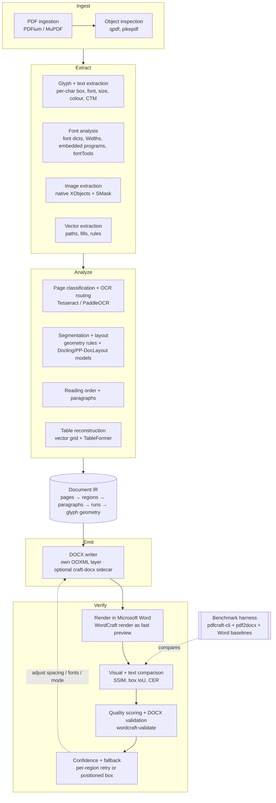

# Report K — Recommended Architecture for PDF Reconstruction

| Field | Value |
| --- | --- |
| Date of research | 2026-11-28 |
| Basis | Source audit (Reports B–G), functional validation (Report H), technology comparison (Report J) |
| Confidence | Medium: architecture is a recommendation; dependency choices should be confirmed by a two-week spike |

## 1. Design stance

- A **modular monolith**: one process, one repository, clear module boundaries. No source evidence justifies microservices.
- **External processes only at the edges**, where isolation pays: Microsoft Word for rendering, optional OCR, optional ArtCraft CLIs for benchmarking and validation.
- **Our own intermediate representation (IR).** PdfCraft's export model (`pdfcraft-export::Block`: text, rect, one size, bold/italic, colour, rotation; no font family) is too thin for fidelity (Report B §7), so we do not inherit it.

## 2. Architecture diagram



Also in `diagrams/recommended_architecture.md`.

## 3. Can ArtCraft contribute to each layer?

| # | Layer | Recommended foundation | ArtCraft contribution | Decision |
| --- | --- | --- | --- | --- |
| 1 | PDF ingestion | PDFium (BSD-3) via pypdfium2, or MuPDF with a commercial licence | `craft-pdf` COS layer, re-exported by `pdfcraft-cos`, opened all 15 test files (Observed, Report H) but adds nothing over PDFium | **Do not use** |
| 2 | Object inspection | qpdf/pikepdf | `pdfcraft-cli info` as a cross-check | Wrap (benchmark only) |
| 3 | Glyph extraction | PDFium char APIs (box, origin, font name/flags, size) | `text_lines`/`text_paragraphs` give line, word and paragraph boxes plus base font | **Reference + cross-check** |
| 4 | Font analysis | Own module over font dictionaries and fontTools | WordCraft's metric-twin list (`fonts/src/word.rs`); PdfCraft does not read font programs | Reference |
| 5 | Image extraction | PDFium/MuPDF | Not needed | Do not use |
| 6 | Vector extraction | PDFium path objects / MuPDF drawings | `craft-metafile` EMF writer could emit vector islands into DOCX | **Optional reuse** (sidecar) |
| 7–8 | Segmentation, layout | Geometric rules + Docling/PaddleOCR layout models | Column-walking reading order, inline-run continuation heuristics | Reference |
| 9 | Tables | Vector-rule grid + ML structure model | Alignment-plus-rules table inference | Reference |
| 10 | OCR routing | Tesseract (Apache-2.0) / PaddleOCR (Apache-2.0) | `ocrs` models are Latin-only and CC-BY-SA-4.0 | Do not use |
| 11 | IR | Own | Export `Page` model too thin | Build |
| 12 | DOCX generation | Own OOXML writer (python-docx plus raw XML for anchors and text boxes) | **`craft-docx` + `craft-wordmodel`**: floats, text boxes, sections, tables, font table | **Optional sidecar** (Report I, Option 3) |
| 13 | Word rendering | Microsoft Word (COM on Windows) | `wordcraft-cli render` as a fast, non-authoritative preview (~55% Word parity, self-estimated) | Wrap for preview only |
| 14 | Visual comparison | Own (scikit-image SSIM, box IoU) | None | Build |
| 15 | Quality scoring | Own harness | `wordcraft-validate` structural checks (stable rule ids) | **Wrap** (QA gate) |
| 16 | Confidence and fallback | Own | PdfCraft's "positioned page" rule is a crude version of this idea | Reference |

## 4. Component responsibility matrix

| Module | Owns | Consumes | Produces |
| --- | --- | --- | --- |
| `ingest` | Opening, decryption, page boxes, rotation normalisation | PDF bytes, password | `PageSource` handles |
| `extract.text` | Per-glyph geometry and style | `PageSource` | `GlyphRun[]` |
| `extract.fonts` | Font identity, metrics, embeddability, substitutes | Font dicts, programs | `FontInfo` table |
| `extract.graphics` | Images and vector paths | `PageSource` | `ImageItem[]`, `PathItem[]` |
| `analyze.route` | Digital / scanned / hybrid per region | Glyph coverage, images | Routing decision; OCR glyphs |
| `analyze.layout` | Blocks, columns, reading order, headers/footers | Glyphs, paths | `Region[]` |
| `analyze.tables` | Grids, merged cells | Paths, glyphs | `Table[]` |
| `ir` | Schema, validation, (de)serialisation | All analyzers | `DocumentIR` (JSON) |
| `emit.docx` | OOXML, styles, sections, anchors | `DocumentIR` | `.docx` bytes |
| `verify` | Word rendering, comparison, scoring, validation | `.docx`, source PDF | `Score`, per-region diffs |
| `control` | Confidence, retries, fallback | `Score` | Adjusted IR or emit options |

## 5. Data flow

1. Each page is classified, then glyphs, fonts, images and paths are extracted in **PDF user space**.
2. Analysis groups glyphs into lines, paragraphs and regions, and resolves reading order, tables, headers and footers.
3. The IR keeps **both** structure and original geometry, so the emitter can choose flowing or positioned output per region.
4. The emitter writes DOCX; the verifier renders it in Word, compares it with the PDF render, and scores each region.
5. Regions under threshold are re-emitted with adjusted parameters, or fall back to positioned text boxes, at most N times.

## 6. Proposed repository structure

```
reconstruct/
  ingest/        pdfium adapter, qpdf inspection
  extract/       text.py, fonts.py, graphics.py
  analyze/       route.py, layout.py, order.py, tables.py, ocr.py
  ir/            schema.py (dataclasses + JSON Schema)
  emit/docx/     styles.py, paragraphs.py, tables.py, anchors.py, fonts.py
  verify/        word_render.py, compare.py, score.py, validate.py
  control/       fallback.py
  cli.py
sidecars/
  docx-writer-rs/   optional: craft-docx behind JSON in, pinned craft-libs commit
bench/
  corpus/, manifests/, harness.py, baselines/ (pdfcraft-cli, pdf2docx, Word)
```

## 7. Major interfaces

```python
class PageSource(Protocol):
    def size(self) -> tuple[float, float]: ...
    def glyphs(self) -> list[Glyph]: ...         # unicode, quad, font_id, size, rgba, render_mode
    def fonts(self) -> dict[str, FontInfo]: ...  # base_font, flags, widths, embedded, program bytes?
    def images(self) -> list[ImageItem]: ...
    def paths(self) -> list[PathItem]: ...

def analyze(page: PageSource) -> PageIR: ...
def emit_docx(doc: DocumentIR, options: EmitOptions) -> bytes: ...
def render_docx(docx: bytes) -> list[Image]: ...  # Word COM; WordCraft/LibreOffice preview
def score(src: Image, out: Image, page: PageIR) -> RegionScores: ...
```

## 8. Dependency choices

| Need | Choice | Licence | Why |
| --- | --- | --- | --- |
| PDF engine | PDFium (pypdfium2) **or** MuPDF/PyMuPDF with a commercial licence | BSD-3 / AGPL-or-commercial | Mature rendering and char-level APIs |
| Inspection | qpdf, pikepdf | Apache-2.0 / MPL-2.0 | Object-level truth |
| Fonts | fontTools | MIT | Metrics, cmap, OS/2 embedding flags |
| Layout and tables | Docling models, PP-DocLayout, TableFormer | MIT / Apache-2.0 / CDLA | Permissive, local |
| OCR | Tesseract, PaddleOCR | Apache-2.0 | Proven, permissive |
| DOCX | Own OOXML layer; optional `craft-docx` sidecar | — / MIT OR Apache-2.0 | Full control of anchors and text boxes |
| Rendering truth | Microsoft Word | Commercial | The only ground truth for DOCX layout |
| DOCX QA | `wordcraft-validate` (via CLI) | MIT OR Apache-2.0 | Catches broken packages early |

## 9. What not to use

PdfCraft's exporter as a foundation; WordCraft's layout as ground truth; the `ocrs` models; any ArtCraft UI crate; copying craft-libs source into our tree.

## Limitations and open questions

- **Limitations:** the architecture is a proposal, not a measured design. Only the ArtCraft rows rest on Report H measurements.
- **Open question:** does the `craft-docx` sidecar beat our own emitter? Report L, Q14, describes the spike that decides this.
- **Open question:** which Word automation route (Windows host, or a Word-backed service) should serve as the rendering oracle?
