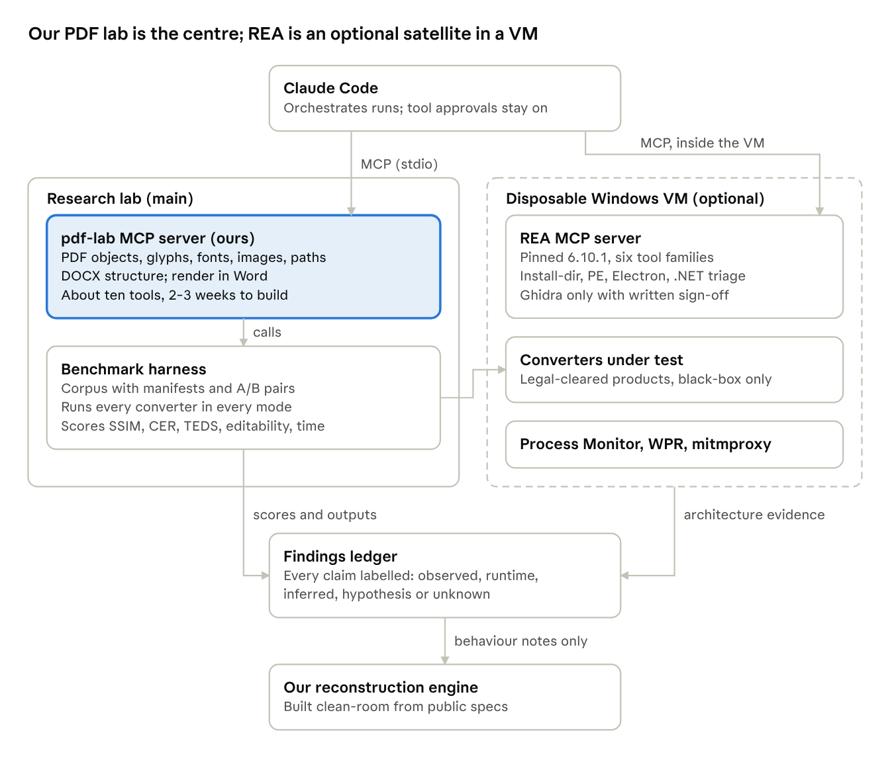

# REA for PDF Reconstruction: Research Reports A–G

Nov 27, 2026 · @Pavan

## Executive summary

**Verdict: use REA only as an optional research tool; do not adopt or extend it.** REA is a capable, actively developed reverse-engineering MCP server, but it has no PDF capability and accelerates roughly 5–10% of the research this project needs (estimate).

- **What REA is.** An MIT-licensed Node.js MCP server and CLI (v6.10.1, 234 tools) that drives Ghidra, IDA, Frida and browsers, and records every result as evidence with explicit unknowns.
- **Where it helps.** Identifying what competitor apps are built from: install-directory triage, PE imports, Electron bundles, .NET metadata.
- **Where it does not.** Reconstruction quality, fidelity scoring, fonts, layout, tables, OCR or DOCX. On Windows, its Ghidra support is experimental and read-only, and Hopper and process capture are unavailable.
- **The real constraint is legal.** Adobe's terms bar reverse engineering, which a regional copy defines to include monitoring inputs and outputs, and bar using its outputs for machine learning. Every competitor test needs legal sign-off first.
- **The real opportunity is product.** Acrobat, Foxit and UPDF all make users choose between flowing text and faithful layout. An engine that delivers both, proven by a public fidelity benchmark, is the differentiator.
- **What to build instead.** A ground-truth test corpus, a benchmark harness that renders through Word, and one small `pdf-lab` MCP server: about 9–12 engineer-weeks for the first cycle.

**First steps:** legal guidance on allowed products and methods; build the corpus and harness; baseline against pdf2docx, Word and LibreOffice; then implement routing, glyph-accurate text, width-matched fonts and render-in-the-loop checks (Report E, items 1–4).

## Report A: REA technical audit

REA is a general-purpose, evidence-tracking reverse-engineering MCP server and CLI that drives other engines (Ghidra, IDA, Frida, browsers). It contains no PDF-specific code: a search of `src/`, `bridge/` and `docs/` for "pdf" found no PDF-handling code; the only hit is a release note about analysing pdf.js's JavaScript. Audited at main commit `580c944a` (2026-11-27) and npm release 6.10.1 (2026-11-20).

### Fact sheet

| Item | Finding | Evidence |
| --- | --- | --- |
| Package | npm `rea-agents` 6.10.1, binaries `rea` / `rea-agents` | [package.json](https://github.com/morluto/rea/blob/main/package.json) |
| Language and runtime | TypeScript on Node.js ^22.23.4, ^24.22.1 or >=26.12.1; engine bridges in Python, Java and Swift | package.json `engines`; [bridge/](https://github.com/morluto/rea/tree/main/bridge) |
| Interfaces | MCP over stdio (default), opt-in Streamable HTTP; the CLI runs the same workflows | [src/server/](https://github.com/morluto/rea/tree/main/src/server); [SECURITY.md](https://github.com/morluto/rea/blob/main/SECURITY.md) |
| Surface | 234 MCP tools and 6 guided prompts in the built catalog (4.0 MB of JSON schema), grouped into 19 tool families | [catalog measurement 2026-11-05](https://github.com/morluto/rea/blob/main/docs/verification/mcp-catalog-codex-2026-11-05.md); [toolFamilyIds.ts](https://github.com/morluto/rea/blob/main/src/contracts/toolFamilyIds.ts) |
| Engines it drives (bring your own) | Ghidra 12.2+ with JDK 25, IDA (headless, attached GUI, or Hex-Rays MCP), Hopper, Kuna, objdump, Rizin, Cutter, JADX, JEB, Frida 17.23.2, GDB/pwndbg, LLDB, tshark, mitmdump, Binwalk, Unblob, WABT, Apktool, adb | [supported-targets.md](https://github.com/morluto/rea/blob/main/docs/reference/supported-targets.md); [THIRD\_PARTY\_NOTICES.md](https://github.com/morluto/rea/blob/main/THIRD_PARTY_NOTICES.md) |
| Bundled runtime deps | 44, including `playwright-core`, `@babel/parser`, `@modelcontextprotocol/server` 2.4.0, `zod`, `isomorphic-git`, `@lydell/node-pty` | package.json `dependencies` |
| License | MIT for REA code. Third-party parts keep theirs: Frida LGPL-2.0 with wxWindows exception; the Windows addon statically links the MinGW GCC runtime (GPLv3 with runtime exception) | [LICENSE](https://github.com/morluto/rea/blob/main/LICENSE); THIRD\_PARTY\_NOTICES.md |
| Claude Code integration | `rea setup` writes `mcpServers.rea` to `~/.claude.json` and a skill to `~/.claude/skills`; a Claude Code plugin manifest is also shipped | [installation.md](https://github.com/morluto/rea/blob/main/docs/getting-started/installation.md); [.claude-plugin/plugin.json](https://github.com/morluto/rea/blob/main/.claude-plugin/plugin.json) |
| Release cadence | 42 releases from 0.2.0 (2026-07-12) to 6.10.1 (2026-11-20): six major versions in about four months | [CHANGELOG.md](https://github.com/morluto/rea/blob/main/CHANGELOG.md) |
| Commit activity | 2,045 commits on main between 2026-11-19 and 2026-11-27; top authors morluto (1,293) and Vincent Koc (270) | `git log` on a 2,000-commit fetch |
| Adoption signals | GitHub page shows 479.6k stars, 116.6k forks, 593 open issues and 546 open PRs (read 2026-11-27); README claims a 50,000-member Discord | [GitHub repo page](https://github.com/morluto/rea) |

Star and fork counts at this scale for a four-month-old project are unusual. I did not treat them as evidence of quality; the code, tests and docs are the evidence used here.

### What REA actually does

- **Static artifact triage, no engine needed.** `inspect_desktop_application` reads an install directory and reports runtime candidates and component markers. PE tools report imports, resources, certificates and overlays. `inspect_managed_artifact` reads .NET metadata and CIL. Archives (ZIP, MSIX, DMG, PyInstaller) are inventoried.
- **JavaScript and Electron analysis.** `analyze_javascript_application` builds a module and IPC graph from an ASAR or extracted tree without running it. `trace_application_feature`, `compare_application_versions` and `recover_javascript_sources` work on that graph.
- **Native decompilation through an engine.** `open_binary`, procedure lists, pseudocode and assembly, string search, cross-references, batch decompile, `compare_functions` and `match_native_functions` across builds.
- **Runtime observation.** Frida attach/spawn with caller-written scripts; GDB, LLDB and Rizin sessions; Chrome-family browser observation over CDP; passive Electron page inspection on a loopback CDP port; HAR/SAZ import; pcap summaries through tshark.
- **Evidence bookkeeping.** Every result is an Evidence record with provenance, limitations and an unknowns ledger, exportable as a bundle. This is REA's most distinctive design trait.
- **Agent-environment building** (AgentEnv / RL environments from recorded web sessions or Linux desktop apps). Not relevant to us.

### What REA does not do

- Parse, render, diff or score PDFs, DOCX files, fonts, layouts, tables or OCR output. None of this exists in the codebase.
- Measure CPU, memory or processing time of a target, or monitor Windows file and registry activity. Process capture records terminal output, exit and selected filesystem snapshots, and only on Linux/macOS ([process-capture.md](https://github.com/morluto/rea/blob/main/docs/guides/runtime/process-capture.md)).
- Recover original source or proprietary algorithms. Native analysis returns engine pseudocode and assembly; the README says the agent then writes its own implementation.
- Sandbox anything. SECURITY.md states REA runs with the host account's permissions and is not a sandbox.

### Native Windows support, capability by capability

| Capability | Status on native Windows | Evidence |
| --- | --- | --- |
| Setup, MCP server, CLI | Supported; Windows x64 native addon is bundled | installation.md |
| Static JS/Electron, .NET, PE triage | Supported (reads files only) | supported-targets.md |
| Ghidra | Experimental "P0": read-only, 27 operations, PE / DOS MZ / raw 6502 only; Windows 10+ x64, Ghidra 12.2+, JDK 25 | [windows-ghidra-p0.md](https://github.com/morluto/rea/blob/main/docs/providers/windows-ghidra-p0.md) |
| IDA | Headless workflow verified with IDA Pro 9.3 on a Windows x64 supervisor; needs your own IDA licence | [ida-provider.md](https://github.com/morluto/rea/blob/main/docs/providers/ida-provider.md) |
| Hopper | Not available: macOS 12+ and Linux x86\_64 only | installation.md, Hopper section |
| Process capture | Unavailable natively; Linux commands only via WSL | process-capture.md |
| Desktop application capture | Linux with X11 only | [desktop-application-capture.md](https://github.com/morluto/rea/blob/main/docs/desktop-application-capture.md) |
| Frida | Tools exposed; REA's own Frida verifier runs only on Linux, so Windows targets through REA are unverified | [frida-instrumentation.md](https://github.com/morluto/rea/blob/main/docs/guides/runtime/frida-instrumentation.md) |
| Browser / Electron CDP observation | Needs a Chrome-family browser or an app that exposes a loopback CDP port | browser-observation.md; electron-observation.md |

### Security implications

- **Host authority.** REA and the engines it launches run as your user. Runtime tools deliberately execute targets. Analyse competitor apps only inside a disposable VM.
- **HTTP transport.** The opt-in HTTP endpoint has no TLS and no client authentication (SECURITY.md). Use stdio only.
- **Prompt injection from targets.** Strings inside analysed binaries reach the agent. SECURITY.md classifies target content as untrusted data; keep Claude Code's tool-approval prompts on.
- **Data leaves the machine via the model.** Analysis runs locally, but tool results go to your model provider (README FAQ). Licence terms of the analysed product may restrict that.
- **Global registration.** Default setup registers REA for every Claude Code project. Use a separate `CLAUDE_CONFIG_DIR` profile or `claude mcp add --scope local`.
- **Supply chain and churn.** About 250 commits a day and six major versions in four months mean frequent interface changes. Pin an exact version and review each upgrade.
- **Context cost.** The full catalog is 234 tools in 19 families. Scope it with `REA_MCP_TOOL_FAMILIES`; for our work `session,artifact,native,managed,electron,application` covers desktop triage, PE imports, .NET, Electron and native analysis, with `frida` or `browser` added only when needed ([toolFamilies.ts](https://github.com/morluto/rea/blob/main/src/contracts/toolFamilies.ts)).
- **Telemetry.** A grep for common analytics SDKs found none; a detached CLI update check exists (`src/cliBuiltinArguments.ts`). This is a limited check, not an audit of all network calls.

### Extensibility

REA has clean seams (contracts in `src/contracts`, ports in `src/ports`, providers under `src/`), but upstream rules require a maintainer scope decision before a new provider ([AGENTS.md](https://github.com/morluto/rea/blob/main/AGENTS.md), CONTRIBUTING.md). Given the churn, a PDF capability belongs in our own small MCP server that runs beside REA, not inside a fork.

### Verdict for our project

- **Useful:** identifying what competitor apps are built from (Electron vs Qt vs .NET, bundled PDF/OCR engines via DLL imports and strings), Electron bundle tracing, and Ghidra/IDA orchestration when a specific question needs disassembly.
- **Irrelevant:** firmware, Android, EVM, GPU, game formats, kernel modules, packet decoders, AgentEnv/RL building, most of the 234 tools.
- **Missing for us:** everything PDF- and DOCX-specific, fidelity metrics, benchmarking and Windows runtime monitoring.

## Report B: PDF software investigation

Every major converter exposes the same user-visible trade-off: a "flowing text" mode that is editable but drifts from the original, and a "page layout" mode that looks right but locks content in text boxes. Nobody publicly claims to deliver both at once, and that gap is the clearest opportunity for us. Open-source tools are strong at extraction, layout detection and OCR, but none produces high-fidelity editable DOCX.

### A. Commercial software (observable behaviour only)

| Product | Observable reconstruction behaviour | Strengths | Weaknesses / unknowns | Relevance |
| --- | --- | --- | --- | --- |
| [Adobe Acrobat](https://www.adobe.com/learn/acrobat/web/convert-pdf-retain-page-layout) (Export PDF) | Two Word modes: Retain Flowing Text and Retain Page Layout; the latter may split text into text-box groups. Runs OCR automatically on scanned pages. Exports DOCX, XLSX, PPTX, RTF, HTML | Reference product; mature font handling | Internals proprietary; EULA forbids reverse engineering (see Report C) | Primary benchmark target |
| [Adobe PDF Extract API](https://developer.adobe.com/document-services/docs/overview/pdf-extract-api/howtos/extract-api) | Returns JSON of semantic elements in reading order with bounds, styling, character boxes; tables as CSV/XLSX/PNG | Lawful, scriptable view of what Adobe's ML infers about structure | Paid API, cloud upload, terms apply; does not generate DOCX | Structure oracle for benchmarks |
| Adobe Illustrator / InDesign | Not researched in depth for this report | — | — | Low: design tools, not converters |
| [ABBYY FineReader PDF 16](https://pdf.abbyy.com/finereader-pdf-corporate-upgrade/) | Claims improved text extraction from non-image PDFs without OCR and better editability of exported Word files; 192 OCR languages; document comparison | Strongest reputation for scanned and mixed documents | Vendor claims only; Windows-centric | Benchmark target for scanned/hybrid |
| [Foxit PDF Editor](https://www.foxit.com/resource-hub/user-guide/foxit-pdf-editor-for-windows/export-pdfs-to-word-powerpoint-rtf-or-plain-text-files) (v2026.2) | Export dialog with Layout Settings (retain text flow vs page layout) and Text Recognition Settings (OCR with language choice) | Foxit's engine was the [code base donated as PDFium](https://www.foxit.com/company/press/1614.html) in 2014 | Converter internals unknown | Benchmark target |
| Nitro PDF Pro | Not researched in depth | — | — | Include in benchmark runs |
| [UPDF](https://updf.com/ocr/pdf-to-word-converter-ocr/?amp=1) | Word modes "Retain Word Flowing Style" and "Retain Word Textbox Style"; OCR toggle inside the convert dialog; markets an "AI-powered" online converter | Cross-platform, low price | What the "AI" does in conversion is unstated | Benchmark target; possible Electron/Qt app to inspect |
| [PDFelement](https://pdf.wondershare.com/) | Converts to Word/Excel/PPT; OCR in 26 languages including right-to-left | Large user base | Vendor claims only | Benchmark target |
| [Apryse Structured Output](https://docs.apryse.com/core/guides/features/office/convert-to-office) | PDF to Word/Excel/PPT/HTML via a separately downloaded prebuilt executable module (Windows, Linux, Mac); also powers Xodo | SDK-grade, scriptable | Commercial licence | SDK competitor; separate executable is easy to observe |
| [Microsoft Word](https://support.microsoft.com/office/opening-pdfs-in-word-1d1d2acc-afa0-46ef-891d-b76bcd83d9c8) (PDF Reflow) | Rule-based mapping to headings, lists and tables; Microsoft lists unsupported items (tables with cell spacing, page borders, frames, multi-page footnotes, endnotes, tags, comments) | Free baseline every user has | Favours reflow over fidelity | Baseline |
| [LibreOffice Draw](https://www.libreoffice.org/bugzilla/show_bug.cgi?id=32249) import | Each line becomes a separate text box; long-standing open bug to make editing easier | Visually close | Practically uneditable | Baseline for "faithful but useless" |

### B. Open-source software

| Project | Role | Licence | Strengths | Weaknesses | Relevance |
| --- | --- | --- | --- | --- | --- |
| [MuPDF / PyMuPDF](https://mupdf.readthedocs.io/en/1.27.0/license.html) | Parse, render, extract chars/spans/fonts/drawings | AGPL or commercial | Fast; rich structured-text and drawing extraction | AGPL means a closed product needs a paid licence | Best research instrument; licence decision for production |
| [PDFium](https://pdfium.googlesource.com/pdfium/) | Parse, render, text with char boxes | BSD-3 (permissive) | Chrome-grade rendering; Foxit lineage | C++ API, fewer high-level helpers | Strong production candidate |
| [Poppler](https://poppler.freedesktop.org/) | Render; `pdffonts`, `pdfimages`, `pdftotext -bbox` | GPL | Handy inspection CLIs | GPL | Research CLIs only |
| [Apache PDFBox](https://pdfbox.apache.org/) | Java parse/extract; PDFDebugger object browser | Apache-2.0 | Object-tree GUI; positional text | JVM | Structural inspection |
| [pdfplumber](https://github.com/jsvine/pdfplumber) / [pdfminer.six](https://github.com/pdfminer/pdfminer.six) | Char, line, rect objects; layout grouping; table finder | MIT | Transparent, easy to debug visually | Slow on large files | Research and ground-truth tooling |
| [pdf2docx](https://github.com/ArtifexSoftware/pdf2docx) | Rule-based PyMuPDF to python-docx converter | Now MIT; no longer maintained by Artifex | Complete readable pipeline (sections, paragraphs, tables, images) | [Documented limits](https://pypi.org/project/pdf2docx/0.5.11/): text-based PDFs, left-to-right, no rotation, 1–2 columns | Best open reference pipeline and a baseline |
| [LibreOffice](https://www.libreoffice.org/) | Office suite with headless conversion | MPL-2.0 | Renders DOCX to PDF headlessly | Its PDF import is weak | Renderer for visual regression of our DOCX |
| [Docling](https://arxiv.org/abs/2408.09869) | Layout detection (DocLayNet-trained) + TableFormer to JSON/Markdown | MIT code; models Apache-2.0 / CDLA | Permissive, local, good tables | Targets extraction, not DOCX fidelity | Layout and table models |
| [PaddleOCR 3.x](https://arxiv.org/abs/2507.05595) | PP-OCR text recognition, PP-StructureV3 parsing, PaddleOCR-VL | Apache-2.0 | Strong OCR and layout, small models | Paddle framework dependency | OCR and layout for scanned pages |
| [MinerU](https://trending8.vercel.app/repo/opendatalab/MinerU) | Pipeline and VLM document parsing | Custom Apache-based licence since 3.1.0 (Apr 2026), with attribution and commercial thresholds | Complex layouts, formulas, CJK | Licence needs legal review | Research comparison |
| [Marker / Surya](https://documentation.datalab.to/docs/on-prem/overview) | Layout, OCR, Markdown conversion | Weights under modified OpenRAIL-M: free only under $5M revenue/funding, and not for products competing with Datalab | Good quality | A PDF converter likely counts as competing | Avoid for product; reading only |
| [Tesseract 5.5.x](<https://en.wikipedia.org/wiki/Tesseract_(software)>) | LSTM line OCR with hOCR/ALTO word boxes | Apache-2.0 | Ubiquitous, CPU-only, Windows builds | Needs clean images; no layout semantics | Baseline OCR |

### C. Specialised technologies

| Technology | Practical options | Strengths | Weaknesses | Relevance |
| --- | --- | --- | --- | --- |
| OCR | Tesseract; PaddleOCR PP-OCR; ABBYY; cloud OCR (Azure, Google, AWS) | Mature for clean scans | Errors on low-quality scans; cloud raises privacy issues | Scanned and hybrid pages |
| Layout analysis | Docling layout model; PaddleOCR PP-DocLayoutV3 (Apache-2.0); VLM parsers (PaddleOCR-VL, MinerU, GLM-OCR) | VLMs lead current benchmarks | VLMs can hallucinate text; GPU cost | Scanned pages; digital pages should prefer native objects |
| Benchmarks | [OmniDocBench](https://github.com/opendatalab/OmniDocBench) (1,651 pages), [PureDocBench](https://arxiv.org/html/2605.07492) (May 2026) | Public, multi-domain | Top OmniDocBench scores have saturated above 90%; PureDocBench's best model scores about 74/100. Both score extraction to Markdown, not editable visual fidelity | No public benchmark matches our goal; we must build one |
| Table reconstruction | Ruled tables from vector paths; TableFormer; Table Transformer; PP-StructureV3 | Vector rules give exact cell grids in digital PDFs | Borderless and spanning cells remain hard | High |
| Font identification | Font dictionaries (BaseFont, subset prefix, FontDescriptor flags, Widths, embedded programs); [fontTools](https://github.com/fonttools/fonttools) (MIT) | Digital PDFs carry exact metrics | Subset fonts lack glyphs for new text; missing ToUnicode maps garble text | Critical for editability |
| Image and vector extraction | Image XObjects with SMask; path operators via PyMuPDF `get_drawings()` | Lossless when kept native | Mapping paths to DOCX shapes is lossy | High for graphic-heavy PDFs |
| Background reconstruction | Inpainting: [LaMa](https://github.com/advimman/lama) (Apache-2.0), OpenCV Telea | Removes rasterised text from scans so it can be retyped | Artifacts on textured backgrounds | Scanned/hybrid pages |
| Editable document generation | [python-docx](https://github.com/python-openxml/python-docx) (MIT), Open XML SDK (MIT), docx4j | Full control of sections, columns, tables, anchored shapes | Word's own layout engine decides final line breaks | Our output layer |

## Report C: Reverse engineering toolkit

The tools that move our project are PDF/DOCX inspectors, a fidelity-scoring harness and cheap Windows observers (Process Monitor, ETW). Disassemblers and debuggers, REA's core, are the least useful category for us and carry the most contractual risk. Almost everything recommended is free.

### Tool evaluation

Relevance: H = needed in the minimum toolkit, M = situational, L = rarely worth it.

| Tool | Purpose | REA integration | Automation | Platform | Cost | Limitations | Relevance |
| --- | --- | --- | --- | --- | --- | --- | --- |
| qpdf / pikepdf | Object-level PDF structure (`qpdf --json`, QDF mode) | None | CLI, Python | Win/Mac/Linux | Free, open source | Structure only, no layout | H |
| PyMuPDF / pdfplumber | Char boxes, fonts, spans, drawings, images | None | Python | Win/Mac/Linux | PyMuPDF AGPL or paid; pdfplumber MIT | PyMuPDF licence for production | H |
| Poppler utils | `pdffonts`, `pdfimages -list`, `pdftotext -bbox` | None | CLI | Win/Mac/Linux | Free (GPL) | Research use only | H |
| DOCX inspection | Unzip and diff `word/document.xml`, styles, numbering; python-docx; Open XML SDK | None | Python, .NET | Win/Mac/Linux | Free | Needs our own normaliser to diff meaningfully | H |
| Visual regression | Render source PDF and exported DOCX (via Word automation or LibreOffice headless) to PNG; score SSIM/pixel diff | None | Python | Win (Word) / any (LibreOffice) | Free | LibreOffice and Word render DOCX differently; Word is the ground truth | H |
| OCR/structure metrics | CER/WER (dinglehopper, jiwer), TEDS for tables, OmniDocBench evaluator | None | Python | Win/Mac/Linux | Free | Measure extraction, not visual fidelity | H |
| [Process Monitor](https://learn.microsoft.com/sysinternals/downloads/procmon) v4.x | File, registry, process, thread, DLL activity; boot logging; thread stacks | None | CLI flags, PML/CSV logs | Windows 10+ | Free | Large logs; driver needs admin | H |
| Windows Performance Recorder / Analyzer (ETW) | CPU sampling, disk I/O, per-module time | None | CLI (`wpr`), WPA | Windows | Free (Windows ADK) | Symbols needed for depth | M |
| Python profilers (py-spy, cProfile, Scalene) | Profile **our** engine | None | CLI | Win/Mac/Linux | Free | — | H |
| Playwright | Drive web converters; capture traces, HAR, screenshots | REA bundles `playwright-core` and reads traces offline | Python/Node | Win/Mac/Linux | Free (Apache-2.0) | Online converters' terms may forbid automation | M |
| mitmproxy | Show whether a desktop app converts locally or uploads to a cloud service | REA imports HAR; native mitmdump only on Linux | CLI, Python addons | Win/Mac/Linux | Free (MIT) | Certificate pinning; terms of service | M |
| Wireshark / tshark | Packet capture | REA pcap tools via tshark (Linux, or Windows with Job Object limits) | CLI | Win/Mac/Linux | Free (GPL) | mitmproxy usually answers the same question faster | L |
| Chrome DevTools / Electron `--remote-debugging-port` | Inspect Electron renderer, bundles, IPC | REA `inspect_electron_fuses`, Electron CDP observation, `analyze_javascript_application` | CDP | Win/Mac/Linux | Free | Fuses can disable inspection; only for Electron apps | M |
| Frida | Hook APIs (file opens, font APIs, DLL loads), time functions | REA Frida tools (verifier Linux-only) | JS/Python | Win/Mac/Linux | Free (LGPL with wxWindows exception) | Executes code in the target; highest ToS risk | L–M |
| Ghidra 12.2+ | Decompile native code | REA provider (Windows: experimental, read-only) | Headless, Java/Python | Win/Mac/Linux | Free (Apache-2.0) | JDK 25; slow on large apps; pseudocode only | L |
| [IDA](https://hex-rays.com/pricing) | Disassembler/decompiler | REA provider (headless, attached, Hex-Rays MCP) | IDAPython, idalib | Win/Mac/Linux | IDA Free is [non-commercial only](https://www.hex-rays.com/ida-free); Pro from €1,099/yr (Essential) | Cost; same legal limits | L |
| [Binary Ninja](https://binary.ninja/purchase/) | Disassembler/decompiler | None in REA | Python API | Win/Mac/Linux | Free (non-commercial/evaluation); Commercial $1,799 | Same legal limits | L |
| Hopper | Disassembler | REA provider | Scripting | macOS/Linux only | Paid | No Windows | L |
| JADX | Android decompiler | REA provider | CLI | Win/Mac/Linux | Free | Android only | L |

IDA Free cannot be used for this work at all: it is licensed for non-commercial use only.

### Legal and contractual limits

| Source | What it permits | What it restricts |
| --- | --- | --- |
| EU [Software Directive 2009/24/EC](https://legislation.gov.uk/eudr/2009/24/article/8/data.pdf) | Art. 5(3): a licensee may observe, study or test a program's functioning to find its underlying ideas and principles; Art. 6: decompilation only for interoperability | Art. 8 makes contract terms contrary to Arts. 5(3) and 6 null and void. The CJEU in [SAS v WPL (C-406/10, 2012)](https://www.fieldfisher.com/en/insights/cjeu-rules-on-the-scope-of-copyright-protection-for-computer-programs) confirmed licensees may observe and test, and functionality itself is not protected |
| India, [Copyright Act 1957 s.52(1)](https://future.indiankanoon.org/doc/257434) | (ab) acts needed for interoperability of an independently created program, if the information is not otherwise readily available; (ac) observation, study or test of functioning to determine ideas and principles, while doing acts necessary for the program's supplied functions | I found no EU-style clause voiding contrary licence terms, so breach-of-contract risk likely remains (inference; confirm with counsel) |
| United States | Fair-use case law has allowed intermediate copying for interoperability; DMCA §1201(f) has an interoperability exemption | Courts have enforced EULA bans on reverse engineering (well-known case law, not re-checked this session) |
| [Adobe General Terms](https://www.adobe.com/legal/terms.html) §17 (effective 3 Oct 2025) | Decompilation only where local law grants it, after first asking Adobe for interoperability information | Bars reverse engineering; the regional copy I read [defines it to include monitoring or tracking inputs and outputs](https://www.adobe.com/qa_en/legal/terms-linkfree.html). Also bars using the software or its outputs to create, train, test or improve ML; §6.18 bars data mining of the Services |
| Other vendors (ABBYY, Foxit, Nitro, UPDF, PDFelement, Apryse) | Not reviewed | Must be read one by one before any test |

Practical consequences:

1. Do not decompile, debug or instrument any commercial PDF product without written legal sign-off for that product and jurisdiction.
2. Even black-box input/output testing of Acrobat may breach Adobe's terms outside the EU. Get counsel's view before Stage 2 runs on Adobe products.
3. Never use competitor outputs to train, tune or test machine-learning components. Adobe forbids it outright, and it contaminates our clean-room story.
4. Publish no competitor comparison without legal review.

## Report D: Research architecture

The simplest architecture that covers every required capability is one Python package with a CLI, one thin MCP server over it, and one nightly benchmark job. REA sits outside that core in a disposable VM.



Claude Code drives our `pdf-lab` server for all PDF and DOCX work; REA and the Windows observers only add architecture evidence. Every result lands in the findings ledger, and only plain-language behaviour notes reach the engine team.

### Missing capabilities and how to provide them

| Capability | Build as | Notes |
| --- | --- | --- |
| PDF structure and object analysis | Existing tools (qpdf `--json`, PyMuPDF), wrapped in `pdf-lab` | No new parsing code |
| Font mapping | Custom Python utility (fontTools + PyMuPDF) | Also the core of Report E technique 3 |
| Layout and text-coordinate comparison | Custom Python utility | Manifest boxes vs extracted boxes; IoU and reading-order distance |
| Image extraction comparison | Custom Python utility | Count, resolution, SSIM per image |
| Vector path comparison | Custom Python utility | Normalised path lists from PyMuPDF drawings |
| DOCX structure inspection | Custom Python utility (python-docx + lxml) | Normalise XML before diffing |
| Visual regression | Custom Python + Word COM renderer | LibreOffice headless as a fallback renderer |
| Automated benchmarking | CLI first, then a nightly CI job | Becomes a research service only if several teams depend on it |
| Claude Code agents | Not needed yet | A skill or CLAUDE.md with the experiment protocol is enough |
| More MCP servers | Not needed | One server; extend it before adding another |

### Proposed `pdf-lab` tools

`inspect_pdf_structure`, `extract_page_glyphs`, `list_fonts`, `list_images`, `list_drawings`, `inspect_docx`, `render_docx_with_word`, `compare_visual`, `score_document`, `run_benchmark`.

Each tool should return a short summary plus file paths to full results. REA's 234-tool, 4 MB catalog shows what happens otherwise: tool definitions crowd out the investigation.

## Research methodology: Stages 1–5

The core of the method is differential testing against a corpus where we know the ground truth for every glyph, box and font. REA contributes to one stage (architecture evidence in Stage 3); everything else needs our own harness.

### Stage 1: Test document creation

1. Author every test PDF from a source we control, so a JSON manifest records each element's text, box, font, size, weight, colour, rotation, z-order, reading order and table cells.
2. Generate with several producers, because producers write PDFs differently: ReportLab (exact placement), Word and LibreOffice exports, LaTeX (columns, maths), Chrome print via Playwright (CSS layouts).
3. Build about 60 "atomic" PDFs, one feature each: simple paragraphs, font families, weights, sizes, two and three columns, ruled and borderless tables, raster images, transparency, vector graphics, rotated text, headers and footers, multilingual and right-to-left text.
4. Add about 40 composite documents: complex layouts, scanned pages, and mixed scanned/digital files. Simulate scans by rasterising our PDFs and degrading them (skew, noise, JPEG, blur), plus real scans of printed copies.
5. Make A/B pairs that differ in one variable only: font embedded vs not, text as glyphs vs outlines, table with vs without rules, vector vs rasterised logo. These pairs are what let us infer techniques later.
6. Version and hash the corpus so every result is reproducible.

### Stage 2: Application testing

1. Run each PDF through each product and each mode (flowing vs page layout; OCR on vs off), only after the legal check in Report C.
2. Prefer official automation: Word COM for PDF Reflow, LibreOffice headless, pdf2docx, Apryse's CLI/SDK, Adobe's Extract API. Use UI automation (pywinauto) only where the licence allows it.
3. Record per run: wall-clock time, peak memory and CPU (psutil sampling or WPR), output hash and the exact product version.
4. Score each output with the harness:

| Measure | How it is computed |
| --- | --- |
| Processing time | Launch-to-output time; seconds per page |
| Export structure | Counts of flowing paragraphs, text boxes, frames, native tables, sections, columns, inline vs floating images |
| Visual similarity | Render the DOCX in Word to PDF, rasterise at 150 dpi, compare to the source: SSIM, pixel diff, per-element box IoU |
| Text accuracy | Character and word error rate against the manifest; reading-order edit distance |
| Font preservation | Family match, size delta, bold/italic match, embedded vs substituted |
| Element editability | Share of text in flowing paragraphs; scripted edit test: insert 20 words in the first paragraph and measure displacement of later content |
| Image preservation | Count, resolution, crop and SSIM per image |
| Table preservation | Native Word table or not; cell-structure similarity (TEDS) |
| Formatting errors | Overflowing or overlapping boxes, missing glyphs, wrong page count |

### Stage 3: Evidence collection

Every finding carries one of five labels: **Observed** (shipped files, notices, DOCX XML), **Runtime** (ProcMon, ETW, network), **Inferred** (from input/output experiments), **Hypothesis**, or **Unknown**.

- **Shipped documentation first.** Third-party notice files in an install directory usually list the open-source engines inside. Reading them is not reverse engineering.
- **Static triage with REA.** `inspect_desktop_application` on the install directory; `inspect_pe_imports`, `inspect_pe_resources` and `inspect_pe_certificates` on main binaries; `analyze_javascript_application` for Electron apps; `inspect_managed_artifact` for .NET. Look for engine names, model files (`.onnx`, OpenVINO) and helper executables.
- **Runtime observation.** Process Monitor during one conversion shows DLLs and model files loaded, temporary intermediate files, child processes and font files touched. mitmproxy shows whether conversion happens in the cloud. WPR shows which modules burn CPU.
- **Export structure.** Diff DOCX XML: text boxes vs frames vs flowing paragraphs, DrawingML vs VML, columns as sections vs tables, font substitution. `docProps/app.xml` may name the generating library.

### Stage 4: Technical analysis

1. Read the A/B pairs: what changed in the output when only one input variable changed.
2. Map patterns to candidate techniques. For example, a scanned page returned as positioned frames over a background image implies OCR plus overlay reconstruction.
3. Use scaling tests: time vs page count, and vs image resolution, separates per-page model inference from per-document work.
4. Write each conclusion as a hypothesis with its evidence label and the experiment that would falsify it.

### Stage 5: Independent implementation

1. Keep a clean-room split: the evidence team writes plain-language behaviour notes; the engine team designs from public sources (ISO 32000-2, ISO/IEC 29500, papers) and our own experiments.
2. Never copy competitor code, assets or outputs into the engine or into any training data.
3. Keep a decision ledger linking each design choice to a public source or one of our experiments.
4. Ship a technique only if it beats the current engine on the corpus without regressions.

### What REA automates versus separate tools

| Stage | REA's part | Separate tools |
| --- | --- | --- |
| 1. Corpus | None | ReportLab, LibreOffice, LaTeX, Playwright, scan-degradation scripts |
| 2. Testing | None (it can read Playwright traces of web converters) | Harness, Word COM, pywinauto, psutil, scoring code |
| 3. Evidence | Install-directory triage, PE imports/resources/certificates, Electron and .NET analysis; Ghidra/Frida only with sign-off | Notice files, Process Monitor, WPR, mitmproxy, DOCX XML analyser |
| 4. Analysis | Its evidence/unknowns discipline is a useful template | Notebooks, Claude Code |
| 5. Implementation | None | Our engine, benchmark gate |

## Report E: Implementation opportunities

The highest-value techniques are per-page routing, glyph-accurate text, width-matched fonts and a render-in-the-loop check against Word. All are independently implementable from the PDF and OOXML specifications plus public research. None requires knowing a competitor's internals. Effort figures are rough engineer-week estimates for a team already shipping a converter (assumption).

### Prioritised techniques

| # | Technique | PDF classes | What it fixes | Effort | Basis |
| --- | --- | --- | --- | --- | --- |
| 1 | **Per-page and per-region routing.** Classify text layers as trustworthy (fonts with ToUnicode, glyph coverage), invisible OCR (render mode 3), or absent; route to native extraction, OCR, or both | All, especially hybrid | OCR errors on digital pages; missing text on scans | 2–3 wk | ISO 32000-2; IBM reports avoiding OCR cut errors and was about 30× faster ([IBM Research](https://research.ibm.com/blog/docling-generative-AI)) |
| 2 | **Glyph-accurate text model.** Keep each glyph's position, transform, font, size, colour and render mode; build words from font-relative spacing; honour ActualText and ligatures; detect fake bold and rotation | Digital, hybrid | Merged or split words, lost rotation, wrong bold | 3–4 wk | PDF spec; pdfminer/PyMuPDF practice |
| 3 | **Font fidelity pipeline.** Normalise names (strip subset prefixes, parse `Family-BoldMT`); embed complete fonts only when their embedding flags allow; otherwise pick the installed or open font whose advance widths best match the PDF `Widths` array; compensate residual width with character spacing | Digital, hybrid | Different look and different line breaks | 4–6 wk | Font metrics; [fontTools](https://github.com/fonttools/fonttools) |
| 4 | **Render-in-the-loop verification.** Render our DOCX in Word, compare line breaks and boxes to the source, adjust spacing or fonts, repeat a bounded number of times | All | Drift that only appears in Word's own layout | 4–6 wk | Our harness (Report D) |
| 5 | **Layout segmentation into Word structure.** Geometric column and block detection (whitespace gutters, XY-cut, vector rules), ML layout model as second opinion; emit true Word section columns, not text boxes | Multi-column, highly formatted | Uneditable text-box soup | 3–5 wk | Docling layout model; PP-DocLayoutV3 (Apache-2.0) |
| 6 | **Table engine.** Ruled tables from vector paths (cluster segments into a grid, infer merged cells); borderless tables from alignment plus an ML structure model; emit native Word tables with exact column widths, row heights, borders, shading | Highly formatted | Tables as text boxes or images | 4–6 wk | TableFormer, Table Transformer, PP-StructureV3 |
| 7 | **Style inference.** Cluster font/size/spacing combinations into Word styles (Normal, Heading 1–3, Caption, List) | Digital, highly formatted | Every paragraph formatted by hand | 1–2 wk | Our own clustering |
| 8 | **Headers, footers and page numbers.** Detect content repeated across pages at the same position; move it into Word headers/footers; replace page digits with PAGE fields | All multi-page | Headers duplicated in the body | 1–2 wk | Cross-page similarity |
| 9 | **Vector preservation.** Group paths into figures; simple shapes as editable DrawingML, complex figures as embedded vector images; full-page art anchored behind text | Graphic-heavy | Rasterised logos and charts | 3–4 wk | PDF path operators; OOXML DrawingML |
| 10 | **Lossless images.** Extract image XObjects at native resolution with soft masks; keep clipping as crop; never recompress | All | Blurry or opaque images | 1 wk | PDF spec |
| 11 | **Scanned-page reconstruction.** Deskew and denoise for OCR only; OCR with word boxes; estimate size from x-height and classify serif/sans/bold; inpaint text pixels from the background (LaMa) and overlay editable text | Scanned, hybrid | Uneditable scans; ghost text behind new text | 5–8 wk | PaddleOCR or Tesseract; [LaMa](https://github.com/advimman/lama) |
| 12 | **Confidence-gated fallback.** Score each region after conversion; below threshold, fall back (e.g. image plus editable text box) and report it | All | Silent failures | 2–3 wk | Our harness |
| 13 | **Scripts and direction.** Right-to-left and complex-script runs, East Asian font slots, vertical text | Multilingual | Broken Arabic, Hebrew, CJK | 2–4 wk | OOXML bidi and text direction |
| 14 | **Transparency handling.** Flatten only complex transparency groups to images; keep text above them editable | Graphic-heavy | Black boxes, lost overlays | 1–2 wk | PDF transparency model |

### Which approach fits which PDF

| PDF class | Recommended approach | Avoid |
| --- | --- | --- |
| Digital (born-digital) | Native extraction only; techniques 2, 3, 5, 6, 7 | OCR and VLM text generation: they add errors and hallucinations |
| Scanned | OCR plus layout model plus background inpainting; technique 11 | Treating the page image as final output |
| Hybrid | Region-level routing; reuse an invisible OCR layer only if it agrees with our own OCR; techniques 1, 11 | One global mode per document |
| Graphic-heavy | Page-layout output: anchored text boxes over preserved vectors and images; techniques 9, 10, 14 | Forcing flowing text, which destroys the design |
| Multi-column | True Word section columns with reading order from geometry; technique 5 | One text box per column or per line |
| Highly formatted (reports, forms) | Native tables, inferred styles, real headers/footers; techniques 6, 7, 8 | Absolute positioning of every paragraph |

## Report F: Business opportunities

The strongest differentiation is closing the flowing-versus-layout gap that Acrobat, Foxit and UPDF all expose as a user choice. A public, measurable fidelity benchmark would make that claim credible. REA's role in competitive research is small: it can tell us what competitors are built from, not how good they are.

### What REA can and cannot contribute

| Research question | Can REA help? | Better source |
| --- | --- | --- |
| Feature discovery | Little: static triage lists bundled components, not features | Vendor docs, release notes, hands-on trials |
| Reconstruction quality | No | Our Stage 2 harness |
| Export quality | No | DOCX structure analyser and visual regression |
| Processing speed | No | Harness timing, WPR |
| Supported formats | Partly: file associations and bundled engines | Product documentation |
| Feature limitations | No | A/B corpus experiments |
| Build-vs-buy intelligence (which engines competitors embed) | **Yes**: PE imports, resources, notices, Electron/.NET analysis | Also third-party notice files |

### Differentiation opportunities

1. **Flowing and faithful at once.** Deliver flowing, editable paragraphs whose line breaks match the original, verified in Word. Competitors make users choose between the two modes.
2. **Native structure, not text boxes.** Real Word tables, section columns, styles, headers and page fields. This is what makes an output usable after conversion.
3. **Per-region fidelity report.** Tell users which regions were approximated and why. No product reviewed here publicly offers this.
4. **Width-matched font substitution.** Keep line breaks when the original font cannot be embedded.
5. **Local, offline processing.** A privacy advantage over cloud converters and cloud extraction APIs.
6. **A published fidelity benchmark.** Public benchmarks score extraction to Markdown, not editable visual fidelity (Report B). Publishing a reproducible method on our own corpus fills that gap; naming competitors needs legal review first.
7. **Developer API.** Compete with SDKs such as Apryse Structured Output and Adobe PDF Services on measurable fidelity.

This report makes no claims about competitor revenue, market share or internal architecture.

## Report G: Installation and execution plan

Install REA only inside a disposable Windows VM, pinned to one version, scoped to six tool families and registered in a separate Claude Code profile. Nothing below has been installed or run in your environment; it is a guide for future approval. Commands come from REA's own [installation guide](https://github.com/morluto/rea/blob/main/docs/getting-started/installation.md).

### Requirements

| Item | Requirement |
| --- | --- |
| Host | Windows 10+ x64 VM with snapshots (Hyper-V or VMware), fixed local NTFS disk |
| Resources | 8 vCPU, 16–32 GB RAM, 100 GB disk (assumption; Ghidra on large binaries needs the RAM) |
| Node.js | 24.x at 24.22.1 or later (REA also accepts 22.23.4+ or 26.12.1+) |
| Claude Code | Installed per Anthropic's documentation, signed in |
| API keys | None for REA. Optional: Adobe PDF Services credentials for the Extract API; an IDA licence only if ever approved |
| Optional engines | Ghidra 12.2+ and a 64-bit JDK 25, only if a specific question needs disassembly |
| Non-REA tools | Process Monitor, Windows ADK (WPR/WPA), mitmproxy, qpdf, Poppler for Windows, LibreOffice, licensed Microsoft Word, Python 3.12 with PyMuPDF, pdfplumber, pikepdf, python-docx, scikit-image, jiwer |

### Steps

1. **Approvals.** Legal sign-off on the list of products to test and the allowed methods (Report C). Security sign-off on REA 6.10.1.
2. **Build the VM.** No corporate credentials or source code inside. Restrict outbound traffic to the npm registry, Anthropic and any approved vendor API. Take a clean snapshot.
3. **Install prerequisites.** Node.js 24, Git, Python 3.12 and the non-REA tools above.
4. **Create an isolated Claude Code profile** (PowerShell):

```
$env:CLAUDE_CONFIG_DIR = Join-Path $HOME ".claude-rea"
```

5. **Preview REA setup, pinned and scoped:**

```
npx -y rea-agents@6.10.1 setup --client claude_code --tool-families session,artifact,native,managed,electron,application --dry-run
```

6. **Review the plan** (paths, backups, skill install), then rerun the same command without `--dry-run` and approve.
7. **Verify:**

```
claude mcp list
npx -y rea-agents@6.10.1 doctor --client claude_code --skill --json
```

8. **Optional Ghidra**, only after approval:

```
$env:GHIDRA_INSTALL_DIR = "C:\tools\ghidra_12.2_PUBLIC"
$env:JAVA_HOME = "C:\Program Files\Java\jdk-25"
npx -y rea-agents@6.10.1 doctor --json
```

9. **Register our own `pdf-lab` MCP server** (Report D) in the same profile.
10. **Run a pilot:** one open-source target (pdf2docx or LibreOffice) through all five stages before any commercial product.
11. **Snapshot after setup;** revert the VM after each competitor session.

### Security rules for the environment

- Use stdio transport only; never enable REA's HTTP endpoint.
- Keep Claude Code's tool approvals on; treat strings from analysed binaries as untrusted.
- Copy target installers into the VM; analyse copies, never the team's workstations.
- Record which target data was sent to the model provider, and confirm that is allowed for each product.

### Rollback

Inside the profile, `claude mcp remove --scope user rea`, delete `$CLAUDE_CONFIG_DIR\skills\reverse-engineer-anything`, then delete the `.claude-rea` profile folder or revert the VM snapshot.

## Final assessment

1. **Is REA genuinely useful for our project?** Marginally. It answers one sub-question well (what a competitor's app is built from) and nothing about reconstruction quality, which is the actual objective.
2. **What share of research could it accelerate?** About 5–10% (estimate). Architecture triage in Stage 3 is perhaps 10–15% of the research effort, and REA roughly halves that part. Corpus building, testing, scoring, analysis and implementation get nothing from it.
3. **Most valuable REA capabilities.** `inspect_desktop_application`, the PE imports/resources/certificates tools, `analyze_javascript_application` for Electron competitors, .NET inspection, and its evidence-and-unknowns discipline as a template for our own findings.
4. **Unnecessary capabilities.** Firmware, Android, EVM, GPU, game formats, kernel modules, packet and signal decoders, AgentEnv/RL building, Hopper, and most debugger tools: roughly 200 of the 234 tools.
5. **Essential complementary tools.** PyMuPDF/pdfplumber, qpdf, Poppler utils, a DOCX structure analyser, Word-based rendering with SSIM scoring, CER/WER and TEDS metrics, Process Monitor, WPR, and Python profilers for our engine.
6. **Can REA show how commercial apps reconstruct documents?** Only indirectly. It can identify bundled engines and trace Electron code. It cannot recover proprietary algorithms from native code in useful time, and Adobe's terms forbid trying. Controlled input/output experiments reveal techniques, and even those need legal clearance for Adobe products.
7. **Can we build a specialised research environment around it?** Yes, but the centre should be our own PDF lab server and benchmark, with REA as an optional satellite in a VM.
8. **Technical and legal limits.** Technical: no PDF awareness; on Windows, Ghidra is experimental and read-only, Hopper and process capture are unavailable; pseudocode is not source; very high churn. Legal: EULA bans (Adobe §17 includes input/output monitoring in its regional wording and bans ML use of outputs); the EU voids such terms for observation and testing, India's s.52(1)(ac) allows study but contract risk likely remains, and US courts enforce EULAs; analysed content goes to the model provider.
9. **Minimum viable toolkit.** Claude Code; our `pdf-lab` MCP server; the corpus generator; a benchmark harness that renders through Word; Process Monitor and WPR. REA is not in the minimum set.
10. **Are custom MCP integrations worthwhile?** One is: a small `pdf-lab` server with about ten tools, around 2–3 engineer-weeks. More servers or custom agents are not worth it until that one proves itself.
11. **Investigate first.** Build the corpus and harness, then baseline our engine against pdf2docx, Word PDF Reflow and LibreOffice. All are legally clean and will show our biggest gaps. In parallel, ask counsel for product-by-product clearance.
12. **Avoid.** Decompiling or instrumenting competitor binaries; using competitor outputs as training or tuning data; trying to make REA PDF-aware; installing REA on development workstations; evaluating all 234 tools; treating GitHub star counts as a quality signal.

## Final recommendation

**Use REA only as an optional research tool. Do not adopt it as core infrastructure and do not extend it.** Invest instead in a corpus, a benchmark harness and a small PDF-specific MCP server; these serve the real goal, an accurate reconstruction engine.

- **Recommended architecture.** Claude Code orchestrates our `pdf-lab` MCP server, the corpus and the benchmark harness. REA runs pinned and scoped inside a disposable Windows VM, called only for occasional architecture triage (Report D).
- **Minimum toolkit.** As in assessment question 9; free apart from Word.

### Estimated effort (first research cycle)

| Work item | Effort (engineer-weeks, estimate) |
| --- | --- |
| Test corpus with manifests and A/B pairs | 2–3 |
| Benchmark harness and scoring (Word rendering, SSIM, CER, TEDS, editability test) | 3–4 |
| `pdf-lab` MCP server | 2–3 |
| REA VM setup and pilot | 0.5 |
| Baseline runs and gap analysis | 1–2 |
| **Total** | **about 9–12** |

### Expected benefits

- A measured gap list for our engine, by PDF class and feature.
- A prioritised roadmap tied to evidence rather than guesses about competitors.
- A regression gate that stops fidelity from slipping.
- Raw material for a credible public fidelity claim.

### Main risks

| Risk | Mitigation |
| --- | --- |
| Breach of vendor licence terms | Counsel signs off each product and method; black-box only; never use outputs for ML |
| REA churn or a compromised release | Pin 6.10.1; VM only; review before each upgrade |
| Over-investing in reverse engineering | Cap REA use at the triage questions in Stage 3 |
| Metrics that reward the wrong thing | Weight editability and visual fidelity together; review samples by hand |
| Font licensing when embedding | Respect embedding flags; fall back to width-matched open fonts |

### Prioritised next steps

1. Get legal guidance on which products and methods are allowed, starting with Adobe.
2. Build the Stage 1 corpus, beginning with the 60 atomic PDFs.
3. Build the harness and run baselines: our engine, pdf2docx, Word PDF Reflow, LibreOffice.
4. Build the `pdf-lab` MCP server once the harness code exists, wrapping it.
5. Start techniques 1–4 from Report E, chosen by the measured gaps.
6. Only then, and only if a question remains that architecture triage can answer, set up REA in the VM.

## Evidence conventions and sources

**How to read claims in this document.** Repository facts cite file paths at main commit `580c944a` (2026-11-27) of a read-only clone; nothing was built, installed or run. Vendor capabilities are vendor statements unless marked otherwise. Effort figures and the 5–10% share are estimates. Findings in future research should carry the five labels from Stage 3: Observed, Runtime, Inferred, Hypothesis, Unknown.

**Not verified in this research:** Adobe Illustrator and InDesign behaviour, Nitro PDF Pro, licence terms of vendors other than Adobe, and US case law (cited from general knowledge).

### Sources

**REA**

- [morluto/rea repository](https://github.com/morluto/rea) and files cited inline: README, package.json, SECURITY.md, DISCLAIMER.md, THIRD\_PARTY\_NOTICES.md, AGENTS.md, CHANGELOG.md
- [Supported targets](https://github.com/morluto/rea/blob/main/docs/reference/supported-targets.md), [MCP contracts](https://github.com/morluto/rea/blob/main/docs/reference/mcp-contracts.md), [installation guide](https://github.com/morluto/rea/blob/main/docs/getting-started/installation.md), [Windows Ghidra P0](https://github.com/morluto/rea/blob/main/docs/providers/windows-ghidra-p0.md), [IDA provider](https://github.com/morluto/rea/blob/main/docs/providers/ida-provider.md), [catalog measurement](https://github.com/morluto/rea/blob/main/docs/verification/mcp-catalog-codex-2026-11-05.md)

**PDF products and tools**

- Adobe: [export layout options](https://www.adobe.com/learn/acrobat/web/convert-pdf-retain-page-layout), [PDF Extract API](https://developer.adobe.com/document-services/docs/overview/pdf-extract-api/howtos/extract-api)
- [ABBYY FineReader PDF 16 upgrade page](https://pdf.abbyy.com/finereader-pdf-corporate-upgrade/)
- Foxit: [export to Word guide](https://www.foxit.com/resource-hub/user-guide/foxit-pdf-editor-for-windows/export-pdfs-to-word-powerpoint-rtf-or-plain-text-files), [PDFium press release (2014)](https://www.foxit.com/company/press/1614.html)
- [UPDF PDF-to-Word OCR article](https://updf.com/ocr/pdf-to-word-converter-ocr/?amp=1); [PDFelement](https://pdf.wondershare.com/)
- [Apryse Structured Output](https://docs.apryse.com/core/guides/features/office/convert-to-office)
- [Microsoft: Opening PDFs in Word](https://support.microsoft.com/office/opening-pdfs-in-word-1d1d2acc-afa0-46ef-891d-b76bcd83d9c8)
- [LibreOffice bug 32249](https://www.libreoffice.org/bugzilla/show_bug.cgi?id=32249)
- [MuPDF licence](https://mupdf.readthedocs.io/en/1.27.0/license.html); [pdf2docx repository](https://github.com/ArtifexSoftware/pdf2docx) and [PyPI page](https://pypi.org/project/pdf2docx/0.5.11/)
- [Docling technical report](https://arxiv.org/abs/2408.09869); [IBM Research on Docling](https://research.ibm.com/blog/docling-generative-AI)
- [PaddleOCR 3.0 technical report](https://arxiv.org/abs/2507.05595); [MinerU licence change (secondary source)](https://trending8.vercel.app/repo/opendatalab/MinerU); [Datalab licensing](https://documentation.datalab.to/docs/on-prem/overview)
- [Tesseract](<https://en.wikipedia.org/wiki/Tesseract_(software)>); [OmniDocBench](https://github.com/opendatalab/OmniDocBench); [PureDocBench](https://arxiv.org/html/2605.07492)

**Toolkit and law**

- [Hex-Rays pricing](https://hex-rays.com/pricing) and [IDA Free terms](https://www.hex-rays.com/ida-free); [Binary Ninja purchase page](https://binary.ninja/purchase/); [Process Monitor](https://learn.microsoft.com/sysinternals/downloads/procmon)
- [EU Directive 2009/24/EC, Art. 8](https://legislation.gov.uk/eudr/2009/24/article/8/data.pdf); [SAS v WPL summary](https://www.fieldfisher.com/en/insights/cjeu-rules-on-the-scope-of-copyright-protection-for-computer-programs)
- [Indian Copyright Act s.52(1)](https://future.indiankanoon.org/doc/257434)
- Adobe General Terms: [global page](https://www.adobe.com/legal/terms.html), [regional copy quoted](https://www.adobe.com/qa_en/legal/terms-linkfree.html)
